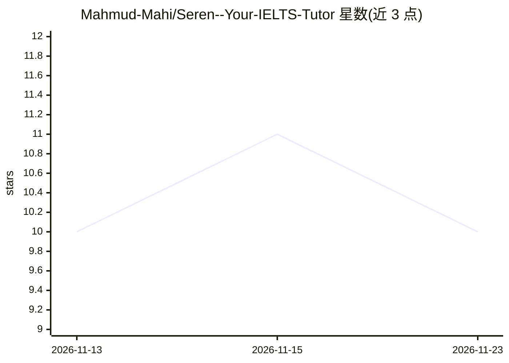

# Mahmud-Mahi/Seren--Your-IELTS-Tutor

⭐ 10 · TypeScript · MIT · 推送 2026-11-13 · [GitHub](https://github.com/Mahmud-Mahi/Seren--Your-IELTS-Tutor) · 个人维护

**AI 雅思口语陪练应用：模拟考试、CEFR 评估与个性化课程**

面向雅思学习者的桌面端口语教练应用：提供完整的剑桥式三段口语诊断测试、四维度（流利度/词汇/语法/发音）评分与预测雅思分数及 CEFR 等级报告、根据弱点生成课程路线，以及休闲聊天与面试模式两种对话练习。语音部分使用本地离线 Whisper（sherpa-onnx）做语音识别，配合多家 TTS；LLM 通过 OpenAI 兼容接口接入，支持级联回退。提供 Windows 安装包与 deb 包，也可 Node.js 源码运行；云同步需自建 Firebase 项目，未配置时以离线模式运行。

## 筛选速览

| 维度 | 判定 | 备注 |
|---|---|---|
| AI 角色 | `ai-native` | 本体是模型或模型工具 |
| 许可风险 | `permissive` | MIT |
| 部署形态 | `desktop` | 安装包/桌面程序 |
| 模型依赖 | local-ok | 支持本地模型 |
| 硬件要求 | — | 无带数字的原话,不猜 |
| 安装摩擦 | `medium` | 含编译或系统依赖之一 |
| 成熟度 | — | 结构信号不足 |

## 能力要点

- 剑桥式三段口语诊断测试与四维度评分报告（预测 0-9 分 + CEFR A1-C2）
- 本地离线 Whisper（sherpa-onnx）语音识别，安装包内置约 280MB 语音模型
- OpenAI 兼容 LLM 接入与可手动调整的级联回退优先级
- PWA 可安装，支持 Firebase 云同步或纯离线模式

## 适用场景

- 备考雅思口语，做完整诊断测试并获取分数报告
- 根据弱点练习个性化课程与模拟面试
- 无 API key 情况下配置本地 LLM 进行语音对话练习

## 场景标签

`聊天机器人` `语音识别` `语音合成` · 领域:对话与助手

## 证据(README 行号)

> L5: **Your personal AI IELTS speaking coach** — practice speaking, get instant CEFR evaluation, and improve with persona
> L66: - **Speech-to-Text**: Local offline Whisper (sherpa-onnx) with a live mic equalizer in the input box
> L186: Edit `.env` with your preferred provider. Seren uses a **cascading fallback** system:

## 星数曲线

2026-11-13 10 → 2026-11-23 10（+0）

---
*卡片 v1 · prompt 1.4 · 生成 2026-11-19 · 置信度 high · 依据 README sha `940c11bd0cbb` · [字段定义](../../DATASET.md)*
