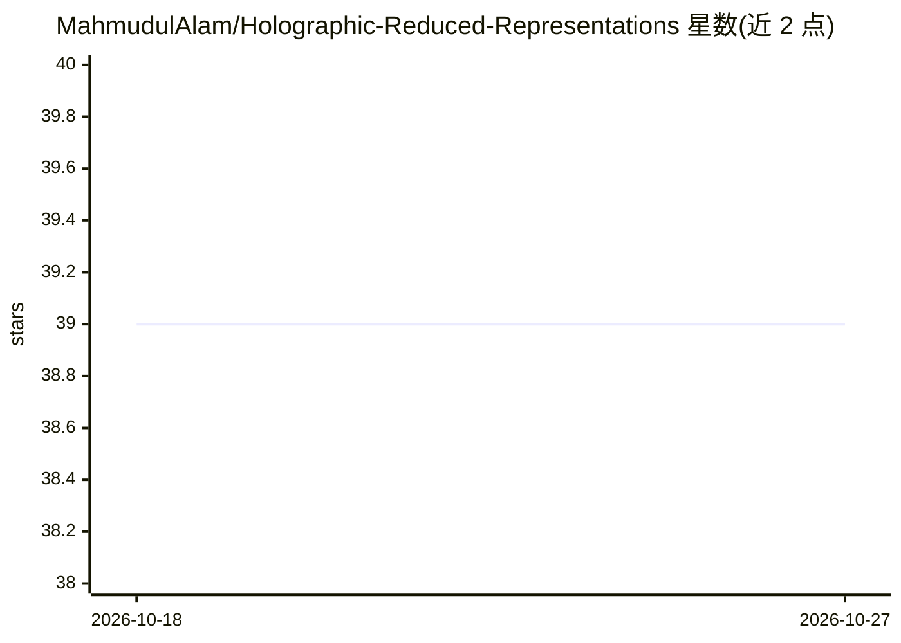

# MahmudulAlam/Holographic-Reduced-Representations

⭐ 39 · Python · MIT · 推送 2025-12-04 · [GitHub](https://github.com/MahmudulAlam/Holographic-Reduced-Representations) · [官网](https://ieeexplore.ieee.org/document/377968) · 个人维护

**神经符号向量化库：用循环卷积绑定/解绑表示组合结构**

Holographic Reduced Representations（HRR）的 Python 库实现：提供基于循环卷积的 binding/unbinding 操作，将抽象概念编码为数值向量并支持检索，向量经投影到复单位幅值球以保证解绑数值稳定。支持 TensorFlow、PyTorch、JAX 与 Flax 后端，并以 Flax module 形式提供绑定/解绑（README 标注为最快路径）。附图像绑定/解绑示例及多篇 ICML/NeurIPS/AISTATS 相关论文。限制：TensorFlow 后端仅支持最后一维的绑定/解绑。面向从事神经符号学习与向量符号结构研究的开发者与科研人员。

## 筛选速览

| 维度 | 判定 | 备注 |
|---|---|---|
| AI 角色 | `ai-native` | 本体是模型或模型工具 |
| 许可风险 | `permissive` | MIT |
| 部署形态 | `library` | 以包/库形式分发 |
| 模型依赖 | — | README 未给出锁定关系 |
| 硬件要求 | — | 无带数字的原话,不猜 |
| 安装摩擦 | `low` | 无编译、无系统依赖或容器化 |
| 成熟度 | — | 结构信号不足 |

## 能力要点

- 基于循环卷积的 binding/unbinding 操作与余弦相似度检索
- 支持 TensorFlow/PyTorch/JAX/Flax 四种后端
- Flax module 形式的绑定/解绑实现
- v1.2.3 起支持实值 FFT（HRR.real）

## 适用场景

- 在神经符号学习模型中表示组合结构与层级关系
- 对图像等数据做绑定/解绑的复合表示实验
- 复现 HRR 相关论文中的向量符号架构操作

## 场景标签

 · 领域:神经符号 AI/表示学习

## 证据(README 行号)

> L33: Holographic Reduced Representations (HRR) is a method of representing compositional structures using circular convo
> L37: HRR library supports TensorFlow, PyTorch

## 星数曲线

2026-10-18 39 → 2026-10-27 39（+0）

---
*卡片 v1 · prompt 1.4 · 生成 2026-10-25 · 置信度 high · 依据 README sha `5397f0f6b2f6` · [字段定义](../../DATASET.md)*
