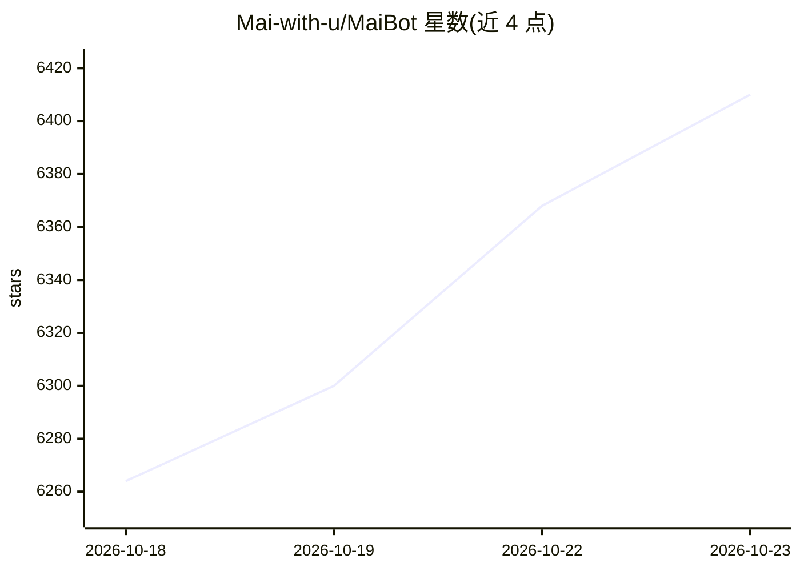

# Mai-with-u/MaiBot

⭐ 6,410 · Python · GPL-3.0 · 推送 2026-10-22 · [GitHub](https://github.com/Mai-with-u/MaiBot) · [官网](https://docs.mai-mai.org/) · 组织维护 · 中文 README

**活跃于 QQ 群聊的 LLM 类人陪伴聊天智能体**

基于大语言模型的可交互智能体（MaiSaka），面向 QQ 群聊场景，以类人风格参与多人闲聊：判断时机决定是否发言、模仿群成员说话风格并学习新词与圈内黑话、基于心理学人格理论持续积累对用户的了解。提供插件系统（API 与事件系统）、WebUI（千禧主题浅色/夜间模式）与 Windows/Mac 一键启动器，Release 页面提供正式版下载，另有稳定 main 分支与开发 dev 分支。设计理念为‘最像而不是好’，定位是陪伴型数字生命而非任务助手。

## 筛选速览

| 维度 | 判定 | 备注 |
|---|---|---|
| AI 角色 | `ai-native` | 本体是模型或模型工具 |
| 许可风险 | `viral` | GPL-3.0 |
| 部署形态 | `desktop` | 安装包/桌面程序 |
| 模型依赖 | — | README 未给出锁定关系 |
| 硬件要求 | — | 无带数字的原话,不猜 |
| 安装摩擦 | `low` | 无编译、无系统依赖或容器化 |
| 成熟度 | — | 结构信号不足 |

## 能力要点

- 多人对话中模仿说话风格、学习新词与圈子黑话
- 基于心理学人格理论持续积累对用户喜恶与行为风格的记忆
- 插件系统提供 API 与事件系统
- 提供 WebUI 与 Windows/Mac 一键启动器

## 适用场景

- 让 AI 以类人方式参与 QQ 群聊闲聊
- 搭建有记忆、有个性演化的陪伴型聊天 bot
- 通过插件系统扩展 bot 功能

## 场景标签

`聊天机器人` · 领域:对话与助手

## 证据(README 行号)

> L29: 麦麦 MaiSaka 是一个基于大语言模型的可交互智能体。
> L104: > - 这个项目最初只是为了给牛牛 bot 添加一点额外的功能，但是功能越写越多，最后决定重写。其目的是为了创造一个活跃在 QQ 群聊的“生命体”。目的并不是为了写一个功能齐全的机器人，而是一个尽可能让人感知到真实的类人存在。

## 星数曲线

2026-10-18 6,264 → 2026-10-23 6,410（+146）

---
*卡片 v1 · prompt 1.4 · 生成 2026-10-20 · 置信度 mid · 依据 README sha `be04d8abbbbb` · [字段定义](../../DATASET.md)*
