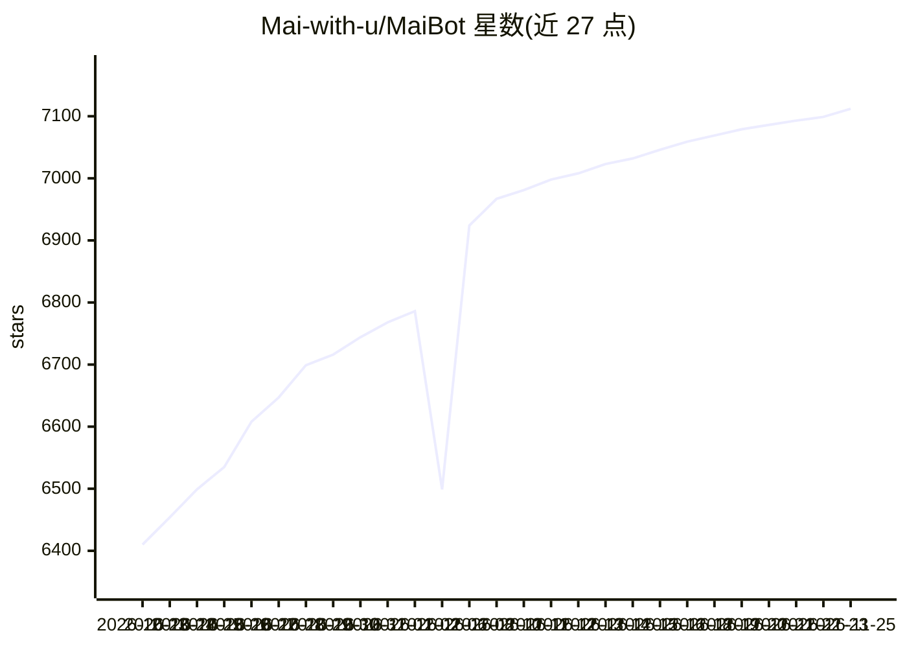

# Mai-with-u/MaiBot

⭐ 7,112 · Python · GPL-3.0 · 推送 2026-11-23 · [GitHub](https://github.com/Mai-with-u/MaiBot) · [官网](https://maibot.chat/) · 组织维护 · 中文 README

**QQ 群聊中拟人化对话的 LLM 数字生命智能体**

基于大语言模型的交互式智能体，运行于 QQ 群聊场景，以闲谈风格对话而非长篇分点回复；能把握群聊气氛决定开口时机，在多人对话中模仿他人说话风格并学习新词与圈内黑话，基于人格理论积累对用户信息、喜恶与行为风格的记忆。提供插件 API 与事件系统供扩展，配套 WebUI、启动器、部署教程与文档中心，通过 Release 页面发布版本，另有 B 站直播等衍生项目。

## 筛选速览

| 维度 | 判定 | 备注 |
|---|---|---|
| AI 角色 | `ai-native` | 本体是模型或模型工具 |
| 许可风险 | `viral` | GPL-3.0 |
| 部署形态 | `desktop` | 安装包/桌面程序 |
| 模型依赖 | — | README 未给出锁定关系 |
| 硬件要求 | — | 无带数字的原话,不猜 |
| 安装摩擦 | `low` | 无编译、无系统依赖或容器化 |
| 成熟度 | — | 结构信号不足 |

## 能力要点

- 群聊中模仿他人说话风格、自主理解新词与黑话
- 基于人格理论积累对用户喜恶与行为风格的长期记忆
- 插件系统提供 API 与事件系统供扩展
- 提供 Windows/macOS 启动器、WebUI 与文档中心

## 适用场景

- 在 QQ 群里部署一个拟人化聊天数字生命
- 为群聊机器人编写插件扩展功能
- 让数字生命在 B 站开播互动

## 场景标签

`聊天机器人` · 领域:对话与助手

## 证据(README 行号)

> L29: 麦麦 MaiSaka 是一个基于大语言模型的可交互智能体。
> L31: MaiSaka 不仅仅是一个机器人，不仅仅是一个可以帮你完成任务的“有帮助的助手”，她还是一个致力于了解你，并以真实人类的风格进行交互的数字生命。她不追求完美，不追求高效，但追求亲切和真实。
> L103: > - 这个项目最初只是为了给牛牛 bot 添加一点额外的功能，但是功能越写越多，最后决定重写。其目的是为了创造一个活跃在 QQ 群聊的“生命体”。目的并不是为了写一个功能齐全的机器人，而是一个尽可能让人感知到真实的类人存在。

## 星数曲线

2026-10-23 6,410 → 2026-11-25 7,112（+702）

---
*卡片 v1 · prompt 1.4 · 生成 2026-11-22 · 置信度 high · 依据 README sha `71cc10db2ca3` · [字段定义](../../DATASET.md)*
