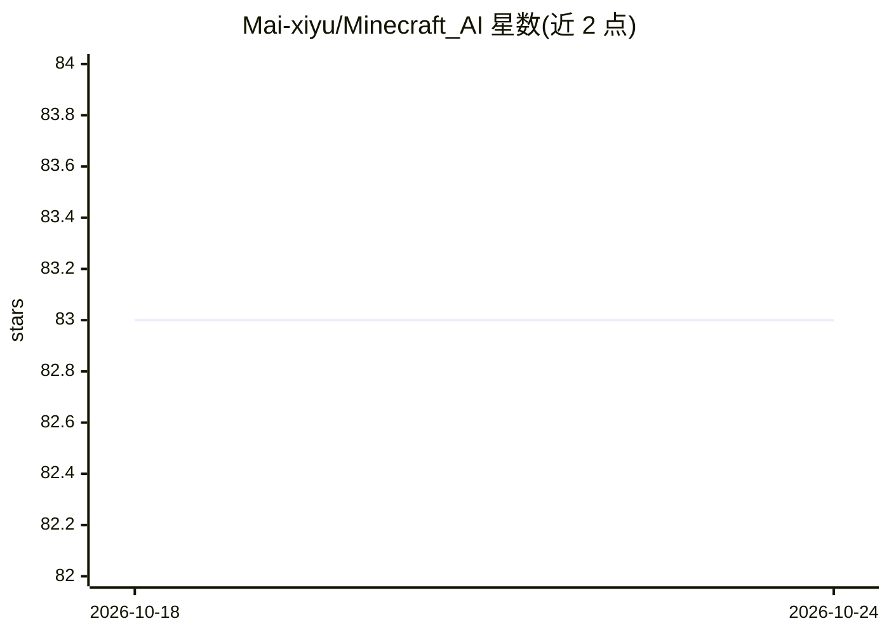

# Mai-xiyu/Minecraft_AI

⭐ 83 · Python · MIT · 推送 2026-09-09 · [GitHub](https://github.com/Mai-xiyu/Minecraft_AI) · 个人维护 · 中文 README

**LLM 驱动的 Minecraft 自主游玩 AI agent 系统**

基于大语言模型的 Minecraft 智能体：AI bot 在游戏内自主探索、采集、合成、战斗、钓鱼、熔炼、跟随玩家等，提供 22 种动作类型，无限自主循环直到手动停止，连续 5 次出错自动暂停。支持任意 OpenAI 兼容 LLM（DeepSeek、GPT-4o、Qwen、Kimi、本地模型），带记忆学习、模式识别缓存与执行反馈回路。PyQt6 双语 GUI 配置与监控，需 Python 3.8+、Node.js 14+ 与 Minecraft Java 版 1.16.5-1.21.1，通过 mineflayer bot 接入局域网开放的世界。

## 筛选速览

| 维度 | 判定 | 备注 |
|---|---|---|
| AI 角色 | `ai-native` | 本体是模型或模型工具 |
| 许可风险 | `permissive` | MIT |
| 部署形态 | `library` | 以包/库形式分发 |
| 模型依赖 | — | README 未给出锁定关系 |
| 硬件要求 | — | 无带数字的原话,不猜 |
| 安装摩擦 | `low` | 无编译、无系统依赖或容器化 |
| 成熟度 | — | 结构信号不足 |

## 能力要点

- 22 种动作类型覆盖移动/挖掘/合成/战斗/钓鱼/箱子操作等
- 任意 OpenAI 兼容 LLM 可接入（含本地模型）
- 记忆学习、模式识别缓存与执行反馈回路（结果回传 LLM 调整策略）
- PyQt6 全异步双语 GUI，实时监控 bot 状态与任务切换

## 适用场景

- 让 AI 在 Minecraft 生存模式中自主采集建造与战斗
- 指定任务或自由行动模式观察 LLM agent 的游戏行为
- 接入不同 LLM 提供商对比 agent 表现

## 场景标签

 · 领域:游戏/AI agent

## 证据(README 行号)

> L10: An intelligent Minecraft AI agent system powered by large language models. The AI agent can autonomously explore, g
> L18: - **Any OpenAI-compatible LLM** — DeepSeek, GPT-4o, Qwen, Kimi, local models, etc.

## 星数曲线

2026-10-18 83 → 2026-10-24 83（+0）

---
*卡片 v1 · prompt 1.4 · 生成 2026-10-24 · 置信度 mid · 依据 README sha `205039d53aad` · [字段定义](../../DATASET.md)*
