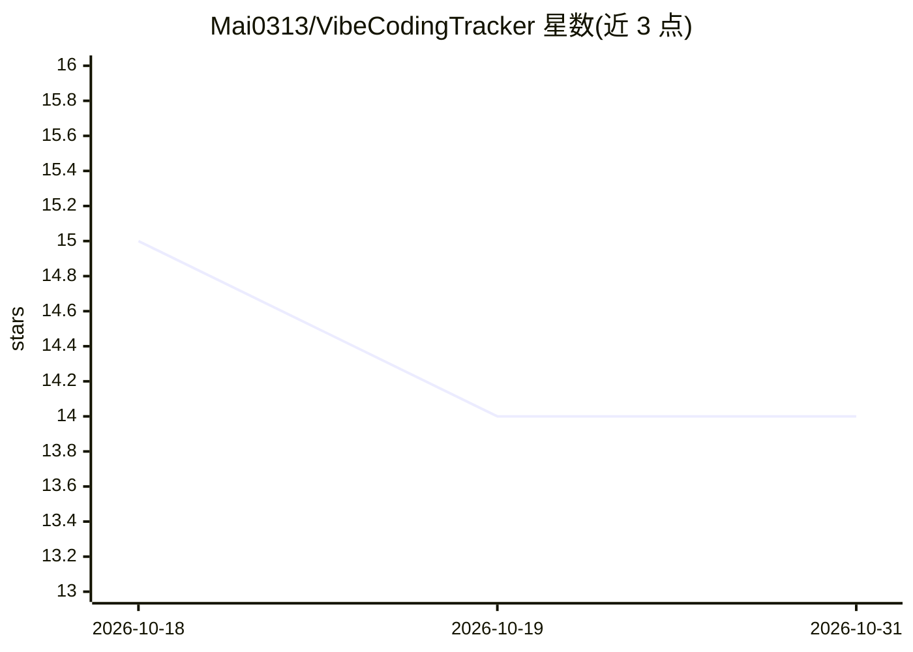

# Mai0313/VibeCodingTracker

⭐ 14 · Rust · MIT · 推送 2026-10-29 · [GitHub](https://github.com/Mai0313/VibeCodingTracker) · [官网](https://mai0313.github.io/VibeCodingTracker/) · 个人维护 · 中文 README

**追踪 Claude Code/Codex 等 AI 编程助手用量与成本的 Rust CLI/TUI**

用 Rust 编写的轻量命令行/终端界面工具，自动扫描本机 Claude Code、Codex、Copilot、Gemini、OpenCode、Cursor、Hermes、Grok、DeepSeek Harness 的日志与数据库，生成 token 用量、按缓存类型拆分的成本、文件操作与工具调用统计；定价来自 LiteLLM 每日缓存。提供交互式 TUI、静态表格、纯文本与 JSON 四种输出，含各平台实时配额面板，并通过 ~/.vct/sessions/ 会话账本做增量扫描。面向使用多种 AI 编程助手的开发者，经 npm/PyPI/crates.io 安装。

## 筛选速览

| 维度 | 判定 | 备注 |
|---|---|---|
| AI 角色 | `ai-ecosystem` | LLM/agent 周边工具 |
| 许可风险 | `permissive` | MIT |
| 部署形态 | `library` | 以包/库形式分发 |
| 模型依赖 | — | README 未给出锁定关系 |
| 硬件要求 | — | 无带数字的原话,不猜 |
| 安装摩擦 | `low` | 无编译、无系统依赖或容器化 |
| 成熟度 | — | 结构信号不足 |

## 能力要点

- 自动扫描 9 种 AI 编程助手本地日志，零配置
- 基于 LiteLLM 定价缓存的成本计算与按模型/日期 token 统计
- TUI/表格/文本/JSON 四种输出，含 Claude/Codex/Copilot/Cursor/Grok 实时配额面板
- 每会话持久账本实现增量扫描，源日志被清理后统计仍保留

## 适用场景

- 查看我在各家 AI 编程助手上花了多少钱、用了多少 token
- 在终端仪表盘实时盯住 Claude/Codex 等订阅配额余量
- 导出 JSON 精确成本数据用于记账或自动化脚本

## 场景标签

`LLM 可观测性` · 领域:评测与运维

## 证据(README 行号)

> L7: **Track your AI coding costs in real-time.** Vibe Coding Tracker is a lightweight, high-performance CLI tool built i
> L34: Automatically detects and processes logs from Claude Code, Codex, Copilot, Gemini, OpenCode, Cursor, Hermes, Grok, 
> L51: |**Dual Analysis**|Token/cost stats (`usage`) + code operation stats (`analysis`)|

## 星数曲线

2026-10-18 15 → 2026-10-31 14（-1）

---
*卡片 v1 · prompt 1.4 · 生成 2026-10-31 · 置信度 high · 依据 README sha `46f53436ddd3` · [字段定义](../../DATASET.md)*
