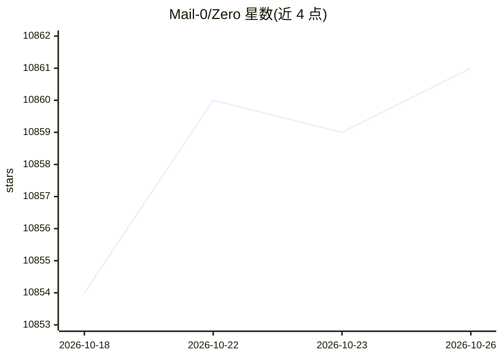

# Mail-0/Zero

⭐ 10,861 · TypeScript · MIT · 推送 2026-10-24 · [GitHub](https://github.com/Mail-0/Zero) · [官网](https://discord.gg/mzJ227YJR) · 组织维护

**开源自托管 AI 邮件客户端，聚合多邮箱收件箱**

Zero（0.email）是开源的邮件应用，支持自托管运行，也可接入 Gmail、Outlook 等外部邮件服务形成统一收件箱；通过 AI Agent 与 LLM 增强邮件处理。技术栈为 Next.js/React 前端、Node.js + Drizzle ORM 后端、PostgreSQL 存储、Better Auth 认证；邮件数据存储于 Durable Object 与 R2 bucket。本地运行需 Node.js 18+、pnpm 10+、Docker 20+，经 git clone 与 pnpm 命令安装，需配置 Better Auth、Google OAuth、Autumn 等环境变量；Twilio 仅 SMS 集成所需。

## 筛选速览

| 维度 | 判定 | 备注 |
|---|---|---|
| AI 角色 | `ai-enhanced` | 去掉 AI 部分产品仍成立 |
| 许可风险 | `permissive` | MIT |
| 部署形态 | `self-host` | docker 或自建部署 |
| 模型依赖 | — | README 未给出锁定关系 |
| 硬件要求 | — | 无带数字的原话,不猜 |
| 安装摩擦 | `low` | 无编译、无系统依赖或容器化 |
| 成熟度 | — | 结构信号不足 |

## 能力要点

- 自托管邮件应用，接入 Gmail/Outlook 等多服务商统一收件箱
- 通过 AI Agent 与 LLM 增强邮件处理
- 声明不追踪、不收集、不售卖用户数据
- 本地开发提供标准与 Devcontainer 两种安装路径

## 适用场景

- 自托管一个不追踪数据的邮件客户端
- 在一个收件箱中管理 Gmail、Outlook 等多个邮件账户
- 用 AI Agent 辅助处理邮件

## 场景标签

 · 领域:邮件/通讯工具

## 证据(README 行号)

> L9: Zero is an open-source AI email solution that gives users the power to **self-host** their own email app while also 
> L17: - 🦾 **AI Driven** - Enhance your emails with Agents & LLMs.

## 星数曲线

2026-10-18 10,854 → 2026-10-26 10,861（+7）

---
*卡片 v1 · prompt 1.4 · 生成 2026-10-20 · 置信度 mid · 依据 README sha `e1aca610fb56` · [字段定义](../../DATASET.md)*
