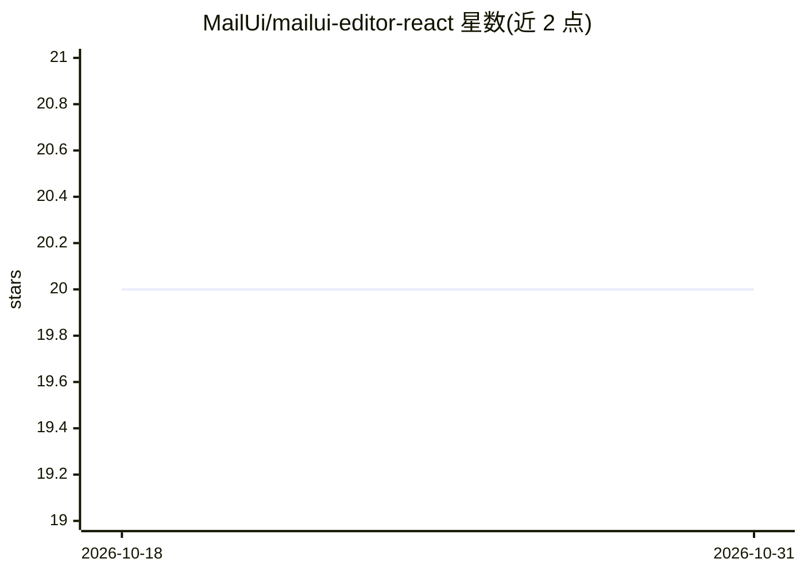

# MailUi/mailui-editor-react

⭐ 20 · TypeScript · MIT · 推送 2025-11-23 · [GitHub](https://github.com/MailUi/mailui-editor-react) · [官网](https://mailui.co) · 组织维护

**React 邮件编辑器组件：为应用嵌入拖拽式邮件设计器**

MailUi 提供的 React 封装组件，将拖拽式邮件设计编辑器嵌入 React 应用：通过 editorRef 访问编辑器实例方法（loadDesign 加载设计 JSON、saveDesign 保存、exportHtml 导出 HTML 与 JSON），支持配置容器 id、最小高度、options、onLoad/onReady 回调等属性。需 React 15.5 及以上，兼容 Chrome/Edge/Safari/Firefox/Opera 等现代浏览器，不支持 Internet Explorer。以 MIT 许可发布，配套 example 目录的示例工程与在线 demo。

## 筛选速览

| 维度 | 判定 | 备注 |
|---|---|---|
| AI 角色 | `ai-enhanced` | 去掉 AI 部分产品仍成立 |
| 许可风险 | `permissive` | MIT |
| 部署形态 | `library` | 以包/库形式分发 |
| 模型依赖 | — | README 未给出锁定关系 |
| 硬件要求 | — | 无带数字的原话,不猜 |
| 安装摩擦 | `low` | 无编译、无系统依赖或容器化 |
| 成熟度 | — | 结构信号不足 |

## 能力要点

- React 封装的拖拽式邮件编辑器组件
- loadDesign/saveDesign/exportHtml 实例方法操作设计 JSON 与导出 HTML
- 属性支持 minHeight、options、onLoad/onReady 等配置
- 通过 PR 贡献多语言翻译

## 适用场景

- 在 SaaS 应用中为用户提供可视化邮件设计功能
- 加载/保存邮件设计 JSON 并导出 HTML 邮件模板
- React 项目中嵌入带回调与配置项的邮件编辑器

## 场景标签

 · 领域:前端组件/邮件工具

## 证据(README 行号)

> L3: Enhance your app with MailUi user-friendly React.js _wrapper component_ for
> L4: designing emails. Enjoy

## 星数曲线

2026-10-18 20 → 2026-10-31 20（+0）

---
*卡片 v1 · prompt 1.4 · 生成 2026-10-28 · 置信度 low · 依据 README sha `5dfbdbee8d23` · [字段定义](../../DATASET.md)*
