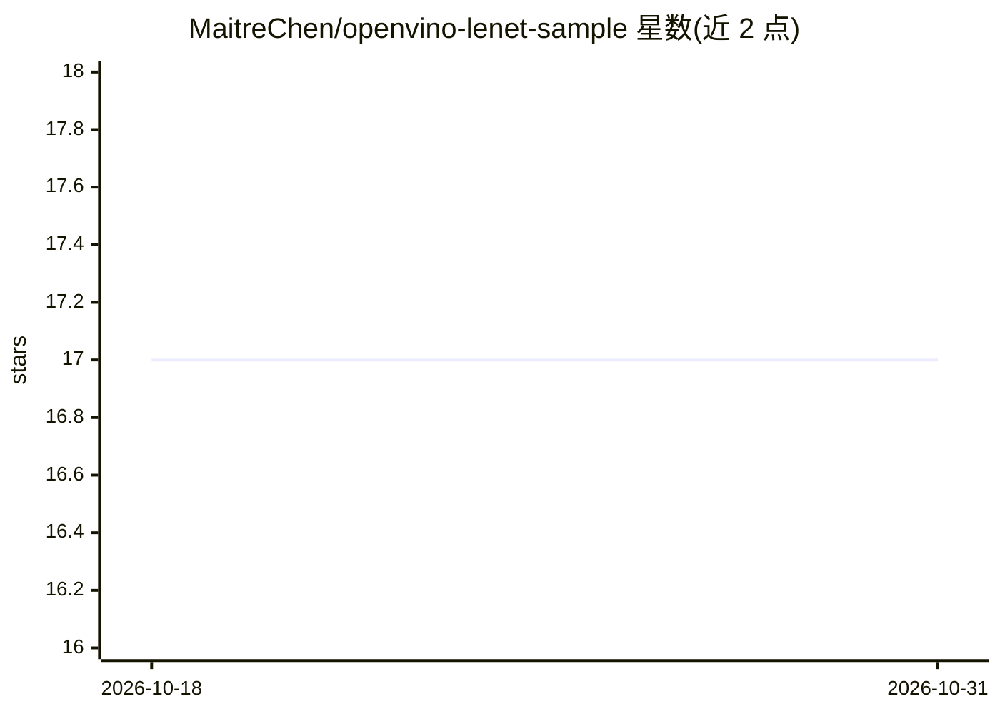

# MaitreChen/openvino-lenet-sample

⭐ 17 · Python · MIT · 推送 2026-04-20 · [GitHub](https://github.com/MaitreChen/openvino-lenet-sample) · 个人维护 · 中文 README

**LeNet 手写数字识别的模型优化与 OpenVINO 部署示例工程**

以 MNIST 手写数字识别为例的深度学习完整流程示例：用 PyTorch 训练 LeNet-5，演示 L1-norm 结构化剪枝（含微调/从头再训练两种策略）、LeNet→MLP 知识蒸馏，导出 ONNX 后用 mo 工具转 OpenVINO IR，提供 PyTorch、ONNX Runtime、OpenVINO Python（sync/async、CPU/GPU/MYRIAD）与 OpenVINO C++ 多条推理路径。面向学习模型训练与边缘部署的开发者，模型体积小（几百 KB），面向树莓派、神经计算棒等资源受限设备。依赖 Windows 10、Python 3.8、Visual Studio 2019、OpenVINO 2022.3.0。

## 筛选速览

| 维度 | 判定 | 备注 |
|---|---|---|
| AI 角色 | `ai-native` | 本体是模型或模型工具 |
| 许可风险 | `permissive` | MIT |
| 部署形态 | `None` |  |
| 模型依赖 | — | README 未给出锁定关系 |
| 硬件要求 | — | 无带数字的原话,不猜 |
| 安装摩擦 | `low` | 无编译、无系统依赖或容器化 |
| 成熟度 | — | 结构信号不足 |

## 能力要点

- L1-norm 结构化剪枝，支持 fine-tune 与 train-from-scratch 再训练
- LeNet 教师→MLP 学生的知识蒸馏训练
- ONNX 导出并用 mo 转换为 OpenVINO IR 模型
- PyTorch / ONNX Runtime / OpenVINO（Python 同步异步 + C++）多路径推理

## 适用场景

- 学习模型剪枝、量化蒸馏与部署的完整流程
- 在 CPU/GPU/NSC2 神经计算棒上运行 OpenVINO 推理验证
- 将训练好的小模型导出 ONNX 并转换为 OpenVINO 格式

## 场景标签

`模型量化` `微调` `模型训练` `教程课程` · 领域:学习与行业

## 证据(README 行号)

> L5: 在模型部署的舞台上，我们追求的是小而美，让模型在树莓派和神经计算棒等计算资源匮乏设备上飞起！虽然我们的LeNet-5模型大小只有几百K，能够轻松部署在边缘设备上，但这个项目不仅仅是为了让你的模型轻装上阵，更是为了让你了解模型优化的魔
> L7: 值得一提的是，在模型部署阶段，我们用的是**OpenVINO Inference API**。这不仅让我们的推理程序变得迅捷高效，也让整个项目更加魔法般的有趣！🚀
> L190: python inference_openvino.py --model model_data/best.xml --img img.jpg --mode sync --device CPU

## 星数曲线

2026-10-18 17 → 2026-10-31 17（+0）

---
*卡片 v1 · prompt 1.4 · 生成 2026-10-30 · 置信度 high · 依据 README sha `26d5834612a0` · [字段定义](../../DATASET.md)*
