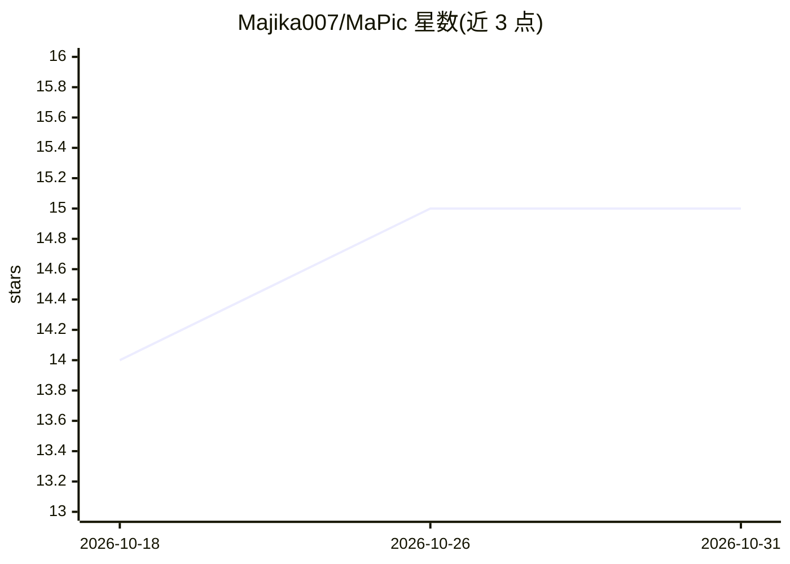

# Majika007/MaPic

⭐ 15 · Python · GPL-3.0 · 推送 2026-05-18 · [GitHub](https://github.com/Majika007/MaPic) · 个人维护

**面向 AI 生成图片的浏览器：读取并展示生成元数据**

基于 PyQt6 的桌面图片浏览器，支持全尺寸查看、缩略图网格、缩放平移与主题自适应。面向浏览 ComfyUI、Automatic1111 等工作流产出的图片的用户：从 PNG parameters 与 JPG UserComment 中提取 prompt、负向提示词、模型/Checkpoint、采样器、步数、CFG、种子、VAE 与多个 LoRA 权重，支持导出 TXT 与一键复制 prompt/seed。终端用户从 Releases 下载 EXE/AppImage，开发者可用 Python 3.11 运行源码，JPG 元数据提取依赖系统 exiftool。

## 筛选速览

| 维度 | 判定 | 备注 |
|---|---|---|
| AI 角色 | `ai-enhanced` | 去掉 AI 部分产品仍成立 |
| 许可风险 | `viral` | GPL-3.0 |
| 部署形态 | `library` | 以包/库形式分发 |
| 模型依赖 | — | README 未给出锁定关系 |
| 硬件要求 | — | 无带数字的原话,不猜 |
| 安装摩擦 | `low` | 无编译、无系统依赖或容器化 |
| 成熟度 | — | 结构信号不足 |

## 能力要点

- 从 PNG/JPG 提取 Stable Diffusion 元数据（prompt、模型、LoRA、seed 等参数）
- 缩略图网格、光标缩放、平移与键盘导航
- 元数据保存为 TXT，prompt 与 seed 一键复制
- 提供 Windows EXE 与 Linux AppImage 发布包

## 适用场景

- 浏览本地文件夹中的 AI 生成图片并查看生成参数
- 从 ComfyUI/A1111 产出图片中提取 prompt、模型与 LoRA 信息
- 按缩略图快速翻找并复用某张图使用的种子和提示词

## 场景标签

 · 领域:图像工具/AI 生成内容浏览

## 证据(README 行号)

> L4: MaPic is an advanced image viewer for AI-generated images, designed for both casual browsing and professional use.
> L7: MaPic reads metadata from PNG and JPG (jpg/jpeg) files created by ComfyUI, Automatic1111 (A1111),

## 星数曲线

2026-10-18 14 → 2026-10-31 15（+1）

---
*卡片 v1 · prompt 1.4 · 生成 2026-10-30 · 置信度 high · 依据 README sha `844c867b4fb4` · [字段定义](../../DATASET.md)*
