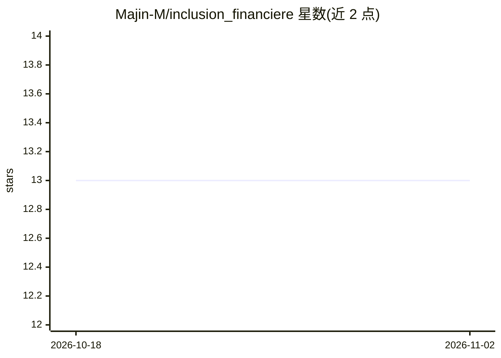

# Majin-M/inclusion_financiere

⭐ 13 · Jupyter Notebook · MIT · 推送 2026-09-29 · [GitHub](https://github.com/Majin-M/inclusion_financiere) · [官网](https://portfolio-data-lovat.vercel.app/projets/inclusion-financiere/) · 个人维护

**预测个人拥有银行账户概率的 Streamlit 机器学习应用**

基于 FinScope 东非四国调查数据的金融包容性预测应用：数据工程侧构建从原始 CSV 到清洗数据集的完整流程（缺失值处理、去重、列名规范化），建模侧训练 200 棵树的 Random Forest 分类器，通过 Streamlit 表单输入国家、年龄、教育程度、职业等社会人口学特征，实时输出个人拥有银行账户的概率。以 portfolio 项目形式呈现，安装依赖后需先在 Jupyter 运行 EDA notebook 生成清洗数据，再以 streamlit run 启动。

## 筛选速览

| 维度 | 判定 | 备注 |
|---|---|---|
| AI 角色 | `ai-native` | 本体是模型或模型工具 |
| 许可风险 | `permissive` | MIT |
| 部署形态 | `library` | 以包/库形式分发 |
| 模型依赖 | — | README 未给出锁定关系 |
| 硬件要求 | — | 无带数字的原话,不猜 |
| 安装摩擦 | `low` | 无编译、无系统依赖或容器化 |
| 成熟度 | — | 结构信号不足 |

## 能力要点

- Random Forest 分类器（200 棵树）预测银行账户持有概率
- 端到端数据工程流程：清洗、去重、列名规范化并导出清洗数据集
- Streamlit 法语交互界面：滑块/下拉框输入特征，实时显示概率
- 提供架构图与数据流图（draw.io 源文件）

## 适用场景

- 输入社会人口学特征估计个人拥有银行账户的概率
- 查看东非四国金融包容性调查数据的清洗与分析流程
- 作为数据工程与 ML 应用开发的参考实现

## 场景标签

 · 领域:数据科学/金融包容性

## 证据(README 行号)

> L3: Ce projet présente une application interactive de machine learning permettant de prédire la probabilité qu'un indivi
> L29: - **Modèle** : Classifieur Random Forest (200 estimateurs) entraîné sur les données nettoyées.

## 星数曲线

2026-10-18 13 → 2026-11-02 13（+0）

---
*卡片 v1 · prompt 1.4 · 生成 2026-10-31 · 置信度 mid · 依据 README sha `e4f5c2822244` · [字段定义](../../DATASET.md)*
