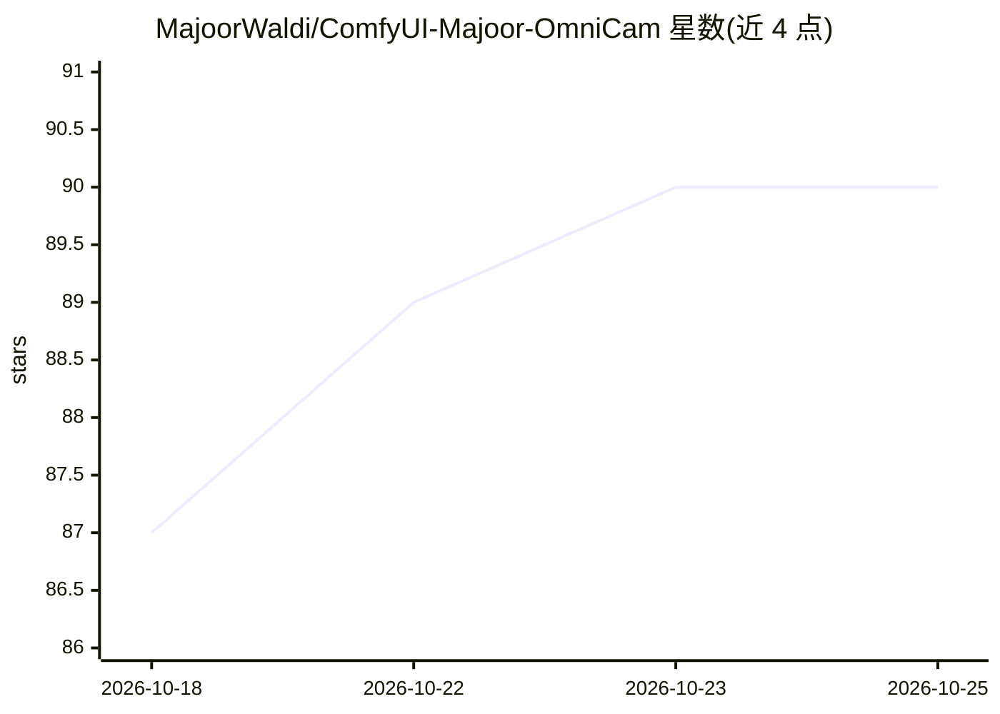

# MajoorWaldi/ComfyUI-Majoor-OmniCam

⭐ 91 · JavaScript · MIT · 推送 2026-10-19 · [GitHub](https://github.com/MajoorWaldi/ComfyUI-Majoor-OmniCam) · 个人维护

**给 ComfyUI 用户的摄像机布局与动画自定义节点集**

ComfyUI 自定义节点集，含 Director（3D 视口内布置摄像机/物体、绘制运动层、关键帧与曲线编辑、录制代理参考视频）、Extractor（从参考镜头恢复 6DoF 摄像机轨迹，或将静态图像/扫描重建为可编辑 3D 场景，使用 MoGe、SAM3.1、VGGT 等后端）、Monitor（将 MotionScene 按目标模型配置编译为 camera embedding / 轨迹 JSON / 参考视频+提示词，含绑定式预检）三部分。支持 Wan、LTX、Hailuo/MiniMax H3、Seedance 等模型的输出配置。需 ComfyUI 0.31+ 与 Python 3.10–3.13，节点整体标注为 experimental。

## 筛选速览

| 维度 | 判定 | 备注 |
|---|---|---|
| AI 角色 | `ai-ecosystem` | LLM/agent 周边工具 |
| 许可风险 | `permissive` | MIT |
| 部署形态 | `None` |  |
| 模型依赖 | — | README 未给出锁定关系 |
| 硬件要求 | — | 无带数字的原话,不猜 |
| 安装摩擦 | `low` | 无编译、无系统依赖或容器化 |
| 成熟度 | `idea` | |

## 能力要点

- MotionScene 作为模型无关的摄像机运动编排文档，经 Monitor 按目标模型配置编译
- Extractor 从参考镜头恢复 6DoF 摄像机轨迹，或用 MoGe/SAM3.1/VGGT 重建可编辑 3D 场景
- Director 提供 3D 视口、路径绘制、12 种插值模式、Bézier 切线与角色姿态编辑
- 预检为绑定式：目标模型节点缺失或接口变化时阻止运行而非输出无效载荷

## 适用场景

- 在 ComfyUI 中为视频生成模型编排摄像机运动并编译为其所需输入格式
- 从一段参考镜头反推摄像机运动用于再创作
- 录制代理参考视频供支持参考视频输入的生成模型使用

## 场景标签

`视频生成` `图像视频处理` · 领域:内容生成

## 证据(README 行号)

> L29:  Majoor OmniCam — camera control for generative video: Extract, Direct, Monitor
> L172: The model compiler. Pick a target profile; Monitor resolves the timeline,

## 星数曲线

2026-10-18 87 → 2026-10-25 90（+3）

---
*卡片 v1 · prompt 1.4 · 生成 2026-10-23 · 置信度 high · 依据 README sha `6b9ed56e54f3` · [字段定义](../../DATASET.md)*
