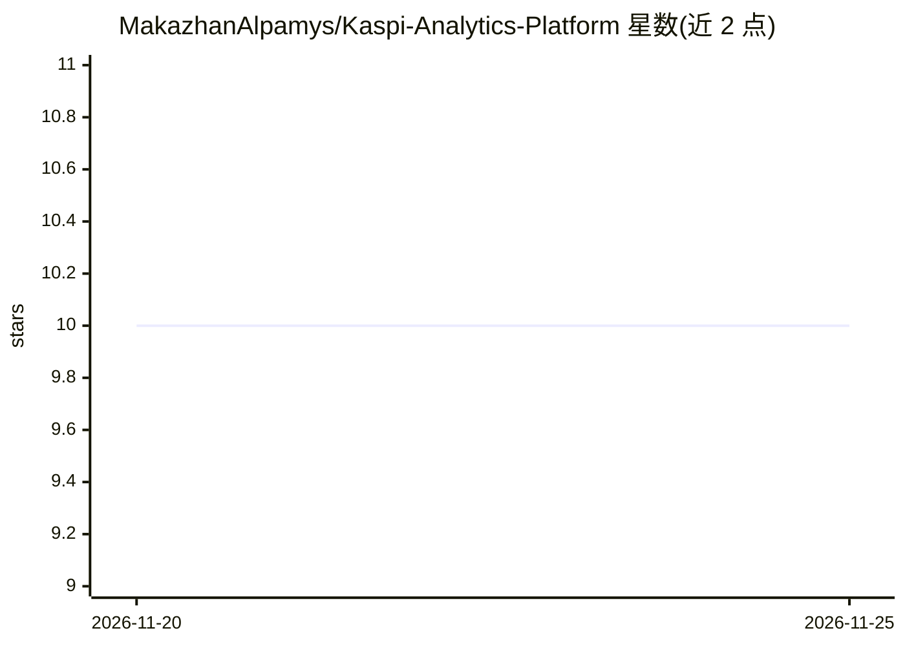

# MakazhanAlpamys/Kaspi-Analytics-Platform

⭐ 10 · TypeScript · 推送 2026-02-14 · [GitHub](https://github.com/MakazhanAlpamys/Kaspi-Analytics-Platform) · 个人维护

**面向电商卖家的 Kaspi.kz 商品分析平台，含销售 ML 预测**

基于 210,000+ Kaspi.kz 市场商品数据的 Web 分析应用：14 个交互页面与 18 个 API 端点，覆盖仪表盘 KPI、ABC/帕累托分析、品类与品牌分析、竞争分析、利基发现、商品对比与 CSV/XLSX 导出。ML 部分使用 scikit-learn 的 GradientBoostingRegressor 预测销量（R²=0.68，训练样本约 21 万条），并提供品类推荐与价格 gap 分析。前端 Next.js + Tailwind，后端 FastAPI + Pandas，需本地克隆仓库、训练一次模型后运行。

## 筛选速览

| 维度 | 判定 | 备注 |
|---|---|---|
| AI 角色 | `ai-native` | 本体是模型或模型工具 |
| 许可风险 | `none` | — |
| 部署形态 | `library` | 以包/库形式分发 |
| 模型依赖 | — | README 未给出锁定关系 |
| 硬件要求 | — | 无带数字的原话,不猜 |
| 安装摩擦 | `low` | 无编译、无系统依赖或容器化 |
| 成熟度 | — | 结构信号不足 |

## 能力要点

- GradientBoosting 销量预测模型（特征：品类、品牌、价格、卖家数）
- 14 个分析页面 + 18 个 FastAPI 端点
- ABC/帕累托、竞争分析、利基发现等电商分析功能
- CSV/XLSX 导出与深色/浅色主题

## 适用场景

- 分析 Kaspi.kz 市场的品类与品牌表现
- 寻找低竞争的市场利基
- 用 ML 预测商品销量并获取选品建议

## 场景标签

`数据分析` · 领域:效率与自动化

## 证据(README 行号)

> L22: **Kaspi Analytics Platform** — это веб-приложение для глубокого анализа товаров маркетплейса Kaspi.kz. Платформа вк
> L35: - 🤖 **ML Прогнозы** — предсказание продаж на основе GradientBoosting (R² = 0.68)

## 星数曲线

2026-11-20 10 → 2026-11-25 10（+0）

---
*卡片 v1 · prompt 1.4 · 生成 2026-11-20 · 置信度 high · 依据 README sha `140844f19d9d` · [字段定义](../../DATASET.md)*
