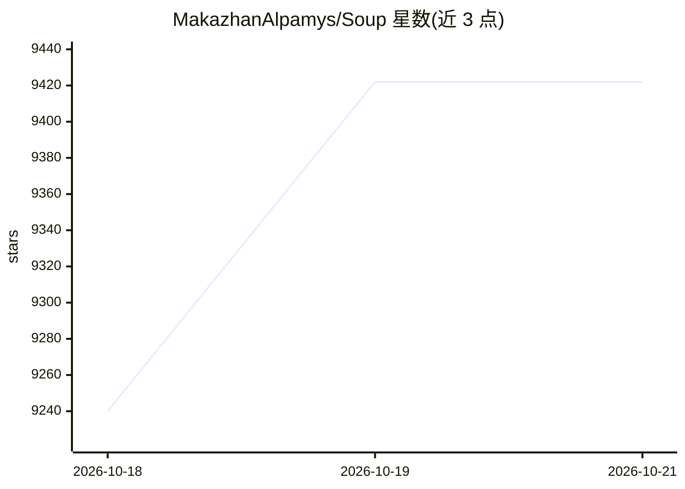

# MakazhanAlpamys/Soup

⭐ 9,422 · Python · Apache-2.0 · 推送 2026-10-19 · [GitHub](https://github.com/MakazhanAlpamys/Soup) · [官网](https://trysoup.dev) · 个人维护

**一条 YAML 配置完成 LLM 微调的 CLI 工具，支持低显存训练**

命令行微调/后训练工具：以单个 YAML 配置驱动 SFT、DPO/GRPO/PPO/KTO/ORPO 等任务，自动处理批大小、GPU 检测与量化；支持 QLoRA 本地训练，layer streaming（BETA、需 opt-in）可将 8B 模型训练压入 4 GB 笔记本 GPU。内置数据格式自动检测、GGUF/ONNX 等导出、Web UI、OpenAI 兼容服务、Docker 镜像与治理/合规模板。要求 Python 3.10-3.12，CUDA GPU 推荐，MPS/CPU 亦可（CPU 为实验性）。

## 筛选速览

| 维度 | 判定 | 备注 |
|---|---|---|
| AI 角色 | `ai-ecosystem` | LLM/agent 周边工具 |
| 许可风险 | `permissive` | Apache-2.0 |
| 部署形态 | `desktop` | 安装包/桌面程序 |
| 模型依赖 | local-ok | 支持本地模型 |
| 硬件要求 | — | 无带数字的原话,不猜 |
| 安装摩擦 | `low` | 无编译、无系统依赖或容器化 |
| 成熟度 | `idea` | |

## 能力要点

- 单个 YAML 配置驱动 SFT/DPO/GRPO 等多种训练任务
- layer streaming（BETA）在 4 GB GPU 上训练 8B 模型
- 兼容 HuggingFace Hub 上任何 AutoModelForCausalLM 可加载的文本生成模型
- 提供 Web UI、Docker 镜像、GGUF/ONNX/TensorRT 导出与 OpenAI 兼容服务

## 适用场景

- 在自己的消费级 GPU 上用 QLoRA 微调开源模型
- 用配置模板快速搭建 chat/code/医疗等微调任务
- 训练后直接导出 GGUF 给 Ollama/llama.cpp 部署

## 场景标签

`微调` · 领域:训练与推理

## 证据(README 行号)

> L7:  Fine-tune and post-train LLMs in one command. No SSH, no config hell.
> L137: soup train --config soup.yaml                 # LoRA, quantization, batching — all handled

## 星数曲线

2026-10-18 9,240 → 2026-10-21 9,422（+182）

---
*卡片 v1 · prompt 1.4 · 生成 2026-10-20 · 置信度 high · 依据 README sha `cd75b3308205` · [字段定义](../../DATASET.md)*
