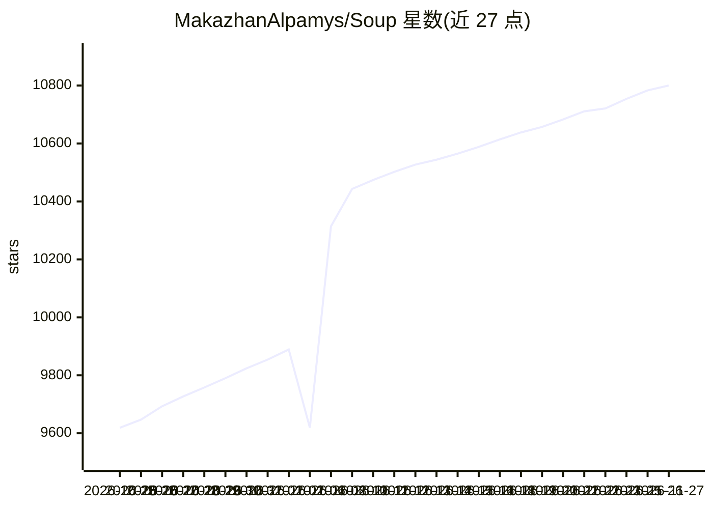

# MakazhanAlpamys/Soup

⭐ 10,800 · Python · Apache-2.0 · 推送 2026-11-26 · [GitHub](https://github.com/MakazhanAlpamys/Soup) · [官网](https://trysoup.dev) · 个人维护 · 中文 README

**一个 YAML 命令微调 LLM 的 CLI，低显存 GPU 可训 8B**

Soup 是命令行 LLM 微调工具：从 YAML 配置一键执行 SFT/DPO/GRPO 等训练任务，自动处理批大小、GPU 检测与量化。Layer streaming（stream_layers: true，BETA）将冻结基座逐层送入 GPU，使 4 GB 笔记本 GPU 可微调 8B 模型；README 附 RTX 3050 Laptop 4 GB 与 H100 的实测数据。提供 Web UI 面板、18 种配置模板、GGUF/ONNX 导出、OpenAI 兼容服务器，支持 HuggingFace Hub 上任意 AutoModelForCausalLM 文本生成模型。训练需 [train] extra；Python 3.11-3.13。

## 筛选速览

| 维度 | 判定 | 备注 |
|---|---|---|
| AI 角色 | `ai-ecosystem` | LLM/agent 周边工具 |
| 许可风险 | `permissive` | Apache-2.0 |
| 部署形态 | `desktop` | 安装包/桌面程序 |
| 模型依赖 | local-ok | 支持本地模型 |
| 硬件要求 | — | 无带数字的原话,不猜 |
| 安装摩擦 | `low` | 无编译、无系统依赖或容器化 |
| 成熟度 | `idea` | |

## 能力要点

- 单 YAML 配置一条命令完成训练，无需 SSH
- Layer streaming 使 4 GB GPU 可微调 8B 模型（opt-in，BETA）
- 支持 SFT/DPO/GRPO/PPO/KTO 等 10+ 训练任务与多源数据格式自动识别
- 导出 GGUF/ONNX/TensorRT 并提供 OpenAI 兼容服务器

## 适用场景

- 在笔记本 GPU 上对 7B/8B 模型做 QLoRA 微调
- 统一 YAML 工作流管理团队的多组训练实验
- 训练后将 LoRA 合并并导出 GGUF 供本地推理
- 带 HIPAA/SOC2 模板与审计日志的合规微调流程

## 场景标签

`微调` `模型量化` `强化学习` · 领域:训练与推理

## 证据(README 行号)

> L7:  Fine-tune and post-train LLMs in one command. No SSH, no config hell.
> L40: Soup turns the pain of LLM fine-tuning into a simple workflow. One config, one command, done.
> L224: Soup works with **any** text-generation model on the

## 星数曲线

2026-10-25 9,619 → 2026-11-27 10,800（+1,181）

---
*卡片 v1 · prompt 1.4 · 生成 2026-11-22 · 置信度 high · 依据 README sha `14e4400c3c4c` · [字段定义](../../DATASET.md)*
