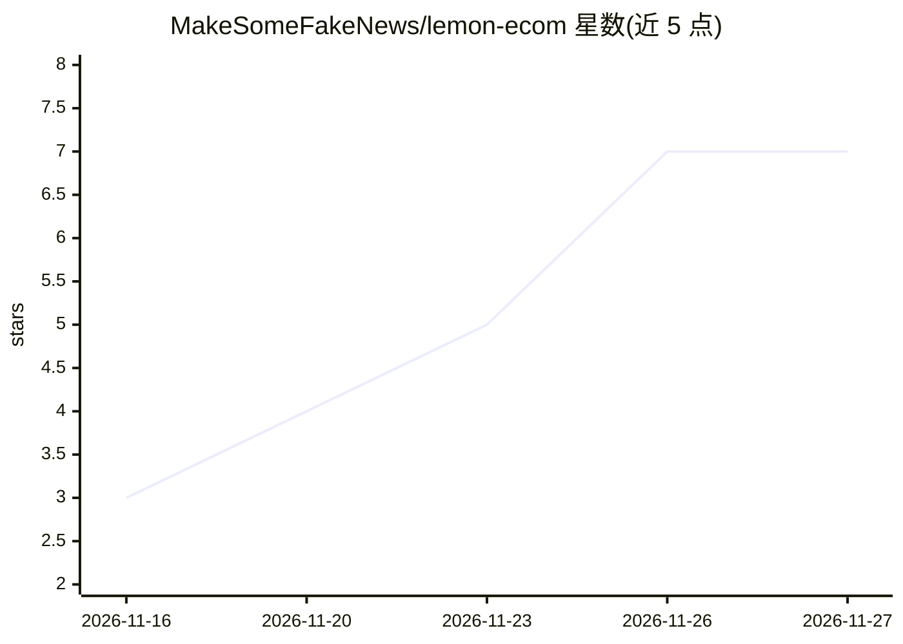

# MakeSomeFakeNews/lemon-ecom

⭐ 7 · Java · GPL-3.0 · 推送 2026-11-13 · [GitHub](https://github.com/MakeSomeFakeNews/lemon-ecom) · [官网](https://makesomefakenews.github.io/lemon-ecom-website/) · 组织维护 · 中文 README

**跨境卖家的开源可私有化部署 ERP，统一管理 11 平台店铺**

面向中小跨境卖家与服务商的开源跨境电商 ERP，技术栈为 Spring Boot 4 + Vue 3 + Flowable。功能覆盖多平台授权拉单与发货回传、刊登与自动调价、FBA 与海外仓、1688 采购、头程物流、结算回款与利润核算、财务凭证与审批流程。AI 部分包括问数、写 Listing、草拟回复与翻译、每日运营日报推送；自动化规则中心提供 19 种触发事件 × 12 种动作。GPL-3.0 协议，声明无商业版；各平台连接器尚未经真实开发者账号联调。

## 筛选速览

| 维度 | 判定 | 备注 |
|---|---|---|
| AI 角色 | `ai-enhanced` | 去掉 AI 部分产品仍成立 |
| 许可风险 | `dual` | GPL-3.0 |
| 部署形态 | `self-host` | docker 或自建部署 |
| 模型依赖 | — | README 未给出锁定关系 |
| 硬件要求 | — | 无带数字的原话,不猜 |
| 安装摩擦 | `low` | 无编译、无系统依赖或容器化 |
| 成熟度 | — | 结构信号不足 |

## 能力要点

- 11 个电商平台连接器：授权、拉单、回传发货与库存、刊登改价
- AI 运营助手：问数、AI 写 Listing 与违禁词检查、AI 运营日报推送钉钉/企业微信/飞书
- 自动化规则中心：19 种触发事件 × 12 种动作，含试运行与模板
- 业财一体：订单出库生成成本与应收，结算报告回写费用并核销

## 适用场景

- 免费私有化部署，替代按店铺和订单量收费的 SaaS ERP
- 统一处理亚马逊、TikTok Shop 等多平台订单与库存回传
- 用 AI 日报和问数工具做店铺经营分析与利润归因
- 服务商基于多租户能力为多家卖家提供 SaaS 运营

## 场景标签

`数据分析` `AI 写作` `工作流自动化` · 领域:效率与自动化

## 证据(README 行号)

> L65: - **AI 与自动化**：AI 问数直接问「上个月哪个店铺利润最高」「哪些 SKU 要紧急补货」；AI 写 Listing 并检查违禁词，草拟买家消息和评价回复；自动化规则把重复操作交给系统
> L232: - **AI operations and automation**: AI analytics tools for e-commerce data (profit decline attribution, ads, retur

## 星数曲线

2026-11-16 3 → 2026-11-27 7（+4）

---
*卡片 v1 · prompt 1.4 · 生成 2026-11-21 · 置信度 high · 依据 README sha `59ffde9fab03` · [字段定义](../../DATASET.md)*
