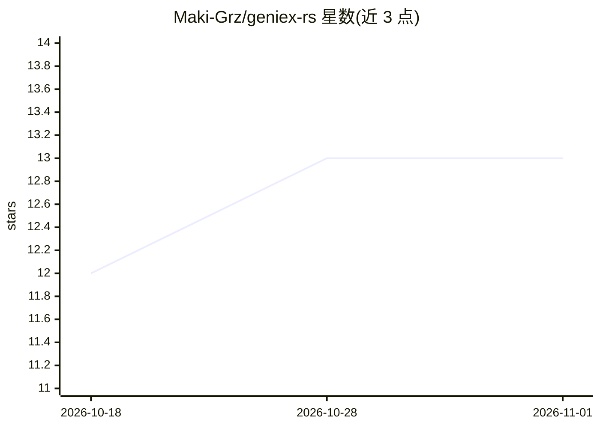

# Maki-Grz/geniex-rs

⭐ 13 · Rust · BSD-3-Clause · 推送 2026-10-10 · [GitHub](https://github.com/Maki-Grz/geniex-rs) · [官网](https://geniex.aihub.qualcomm.com/en/get-started/what-is-geniex) · 个人维护

**Qualcomm GenieX SDK 的 Rust 绑定：在骁龙设备本地跑 LLM/VLM**

社区维护的高层 Rust 封装，包装 Qualcomm GenieX C API（geniex.h），使 Rust 开发者能在 Snapdragon 芯片的 Hexagon NPU、Adreno GPU 或 CPU 上本地运行 GGUF 模型（或 AI Hub 预编译包）。支持 Windows ARM64（X Plus/X Elite）、Linux ARM64 与 x86_64 模拟。提供 RAII 内存管理、流式 token 迭代器、ChatSession、KV cache 与 OpenAI 兼容本地服务器。构建需 Rust 1.70+、LLVM/Clang 与 GenieX C SDK 二进制；处于 Developer Preview 状态，非 Qualcomm 官方产品。

## 筛选速览

| 维度 | 判定 | 备注 |
|---|---|---|
| AI 角色 | `ai-ecosystem` | LLM/agent 周边工具 |
| 许可风险 | `permissive` | BSD-3-Clause |
| 部署形态 | `None` |  |
| 模型依赖 | — | README 未给出锁定关系 |
| 硬件要求 | — | 无带数字的原话,不猜 |
| 安装摩擦 | `low` | 无编译、无系统依赖或容器化 |
| 成熟度 | `idea` | |

## 能力要点

- 在 Hexagon NPU / Adreno GPU / CPU 上运行 GGUF 模型的安全 Rust API
- 后台线程 LlmIterator 流式生成 token，零外部异步依赖
- OpenAI 兼容本地 API 服务器（openai_server）
- VLM 多模态、KV cache 保存/加载、运行时硬件后端别名解析

## 适用场景

- 在 Snapdragon X 笔记本上用 Rust 本地运行 Qwen/Llama/Gemma 等 GGUF 模型
- 为骁龙设备构建本地推理服务并暴露 OpenAI 兼容 API
- 在 Dragonwing QCS9075 等 IoT/Edge 板卡上部署 LLM 推理

## 场景标签

`推理引擎` · 领域:训练与推理

## 证据(README 行号)

> L19: GenieX is an **on-device Gen AI inference runtime for Qualcomm devices**. `geniex-rs` provides safe, idiomatic, hig
> L21:  GenieX architecture: Rust bindings, CLI, Python, Java, Docker, and OpenAI-compatible Serve interfaces sit on a sin

## 星数曲线

2026-10-18 12 → 2026-11-01 13（+1）

---
*卡片 v1 · prompt 1.4 · 生成 2026-10-31 · 置信度 high · 依据 README sha `f84e0a0b02c2` · [字段定义](../../DATASET.md)*
