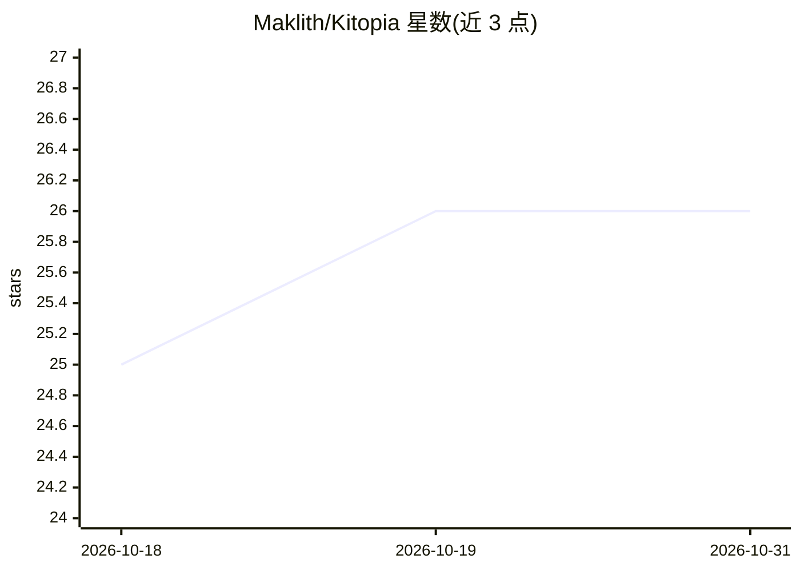

# Maklith/Kitopia

⭐ 26 · C# · GPL-3.0 · 推送 2026-10-30 · [GitHub](https://github.com/Maklith/Kitopia) · 个人维护 · 中文 README

**带本地 AI 语义搜索与离线 OCR 的桌面效率工具箱**

基于 .NET/Avalonia 的 Windows 桌面效率工具，功能覆盖全能搜索与启动、空格文件预览、截图标注与离线 OCR、划词翻译、图片视频批量压缩、批量重命名、局域网跨设备互传、节点化工作流与插件生态。AI 部分：本地 ONNX 模型驱动的语义搜索与 OCR（可选 CPU/GPU/OpenVINO 后端），去掉 AI 后其余功能仍可独立使用。数据本地优先，GPL-3.0 开源，Windows 提供安装包与便携版，Linux 适配中。

## 筛选速览

| 维度 | 判定 | 备注 |
|---|---|---|
| AI 角色 | `ai-enhanced` | 去掉 AI 部分产品仍成立 |
| 许可风险 | `viral` | GPL-3.0 |
| 部署形态 | `desktop` | 安装包/桌面程序 |
| 模型依赖 | local-ok | 支持本地模型 |
| 硬件要求 | — | 无带数字的原话,不猜 |
| 安装摩擦 | `medium` | 含编译或系统依赖之一 |
| 成熟度 | — | 结构信号不足 |

## 能力要点

- 本地 ONNX 模型的语义搜索与离线 OCR，可选 CPU/Windows GPU/Intel OpenVINO 后端
- 节点化情景编辑器连接截图、OCR、翻译等节点构建工作流，支持情景市场
- 插件中心安装管理扩展，官方扩展 KitopiaEx 提供二维码识别、压缩等能力
- 数据本地优先，索引/OCR/向量数据存放在本地，不经过第三方云

## 适用场景

- 用 Alt+Space 快捷启动应用、搜文件、算数学、查汇率
- 截图后离线提取文字并做标注、翻译与取色
- Windows 与 Android 手机在局域网免登录互传文件
- 通过节点编排把截图、OCR、翻译串成自动化工作流

## 场景标签

`语义搜索` `OCR` `工作流自动化` · 领域:效率与自动化

## 证据(README 行号)

> L11: > 集成搜索与启动、本地 AI 语义搜索、文件速览、截图与 OCR、跨设备互传、媒体压缩和可视化工作流的桌面工具。
> L93: 在插件中心安装、启用和管理扩展。OCR 与语义搜索使用本地 ONNX 模型，可选择 CPU、Windows GPU 或 Intel OpenVINO 后端，具体设备支持取决于插件和运行环境。
> L109: > 3. **本地 AI 与 OCR**：首次使用本地语义检索和离线 OCR 时，系统会自动准备好轻量模型，无需手动配置复杂的 Python 或 AI 环境。

## 星数曲线

2026-10-18 25 → 2026-10-31 26（+1）

---
*卡片 v1 · prompt 1.4 · 生成 2026-10-26 · 置信度 high · 依据 README sha `86dc1bfe7001` · [字段定义](../../DATASET.md)*
