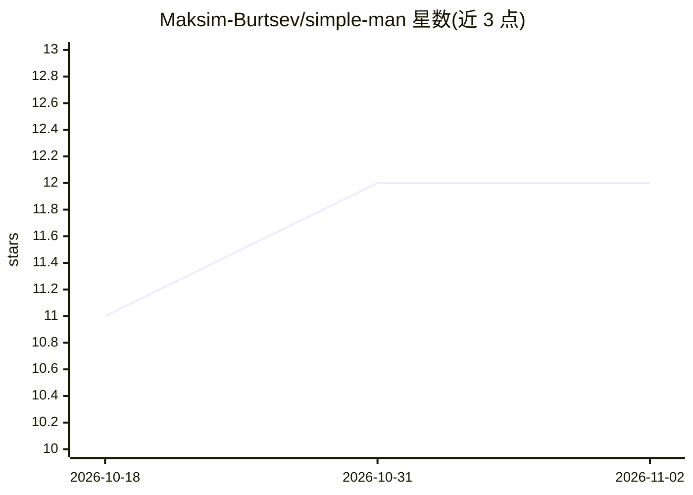

# Maksim-Burtsev/simple-man

⭐ 12 · Python · MIT · 推送 2026-11-01 · [GitHub](https://github.com/Maksim-Burtsev/simple-man) · 个人维护

**让编码 agent 少说话多办事的沟通策略技能（agent skill）**

面向编码 agent 的沟通风格约束技能（以"船长"人设呈现）：要求输出短促、事实性——只报阻碍、修复与风险，不写客套、复述与多余建议。实测数据显示 −32.4% 输出 token、事实零丢失（84 个真实用例、2,479 次预注册实时调用中含 266 次真实 Claude Code 会话）。机制上对指定格式的输出视为契约不做压缩，教程与详细报告全文展开，避免误触发。通过 npm 安装为 Claude Code 等编码 agent 的技能使用。

## 筛选速览

| 维度 | 判定 | 备注 |
|---|---|---|
| AI 角色 | `ai-ecosystem` | LLM/agent 周边工具 |
| 许可风险 | `permissive` | MIT |
| 部署形态 | `self-host` | docker 或自建部署 |
| 模型依赖 | locked-api |  |
| 硬件要求 | — | 无带数字的原话,不猜 |
| 安装摩擦 | `low` | 无编译、无系统依赖或容器化 |
| 成熟度 | — | 结构信号不足 |

## 能力要点

- −32.4% 输出 token，基于 84 个真实用例测量
- 事实核对清单验证零丢失（阻碍、失败检查、标识符、风险）
- 请求格式视为契约，教程/详细报告不压缩
- 2,479 次预注册实时调用（含 266 次真实 Claude Code 会话）原始记录提交

## 适用场景

- 让 Claude Code 等编码 agent 的回答更短、只保留可行动事实
- 减少阅读 agent 输出的时间与 token 开销
- 安全审查、状态汇报、诊断等场景获得带修复方案的精简输出

## 场景标签

`提示工程` · 领域:Agent 开发

## 证据(README 行号)

> L20: Simple Man is the other voice at the helm — a captain who has run ships for
> L24: tested on 2,479 preregistered live calls — 266 of them real Claude Code

## 星数曲线

2026-10-18 11 → 2026-11-02 12（+1）

---
*卡片 v1 · prompt 1.4 · 生成 2026-11-01 · 置信度 low · 依据 README sha `74c34d117605` · [字段定义](../../DATASET.md)*
