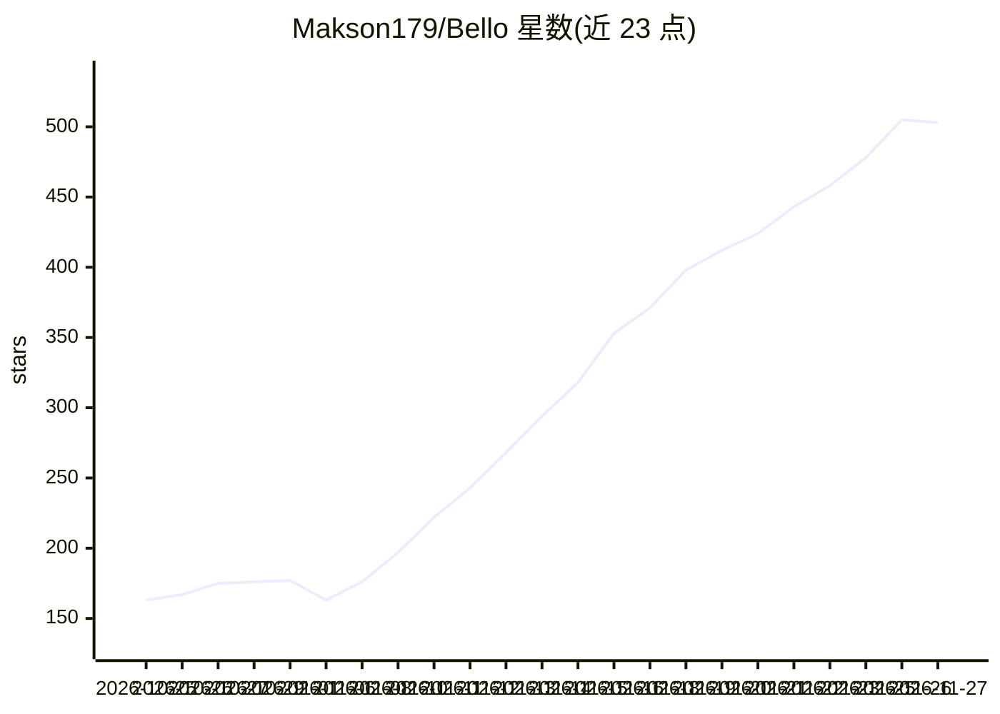

# Makson179/Bello

⭐ 503 · Python · MIT · 推送 2026-11-07 · [GitHub](https://github.com/Makson179/Bello) · 个人维护

**给编码 Agent 加监督/审查/对抗角色的多模型编排 CLI**

Bello 将一个编码任务交给 coder 执行，并在其外层提供四个可独立开关的角色：运行时监督、完成审查、对抗测试与本地日志蒸馏（微调的 ModernBERT 模型在本地压缩工具输出）。每个角色可配置独立模型，来源支持 Codex/Claude Code 订阅或 API 供应商；角色间可互相委托子代理。另提供 Goal 模式（按可测量目标持续运行）、NNC 上下文压缩与 Smart Execution 并行工具执行。通过 pipx 安装，可作为 Codex/Claude Code 插件在编码 Agent 内调用。

## 筛选速览

| 维度 | 判定 | 备注 |
|---|---|---|
| AI 角色 | `ai-ecosystem` | LLM/agent 周边工具 |
| 许可风险 | `permissive` | MIT |
| 部署形态 | `None` |  |
| 模型依赖 | locked-api |  |
| 硬件要求 | — | 无带数字的原话,不猜 |
| 安装摩擦 | `low` | 无编译、无系统依赖或容器化 |
| 成熟度 | — | 结构信号不足 |

## 能力要点

- coder 外四个可选角色：监督、审查、对抗、本地日志蒸馏，各自独立模型
- 日志蒸馏用本地运行的微调 ModernBERT，无需云端调用
- Goal 模式按可测量目标持续运行，完成审查不设次数上限
- NNC 会话历史压缩，阈值与保留长度可配置

## 适用场景

- 用订阅内已有模型搭建多角色编码流水线，降低限额消耗
- 让监督者在长任务中纠正跑偏并重启失败的运行
- 对可量化目标的任务（如基准分数）用 Goal 模式持续迭代
- 在编码 Agent 内通过插件让 Agent 推荐并代跑 Bello 配置

## 场景标签

`多智能体` `编码 Agent` · 领域:Agent 开发

## 证据(README 行号)

> L16: Bello runs a coding task through a coder and four optional parts: a runtime
> L120: adversary rounds is a setting. Roles can use different providers, including
> L135: Claude Code plugins reads the task and the repository and recommends one

## 星数曲线

2026-10-25 163 → 2026-11-27 503（+340）

---
*卡片 v1 · prompt 1.4 · 生成 2026-11-25 · 置信度 high · 依据 README sha `7990f31f8d2d` · [字段定义](../../DATASET.md)*
