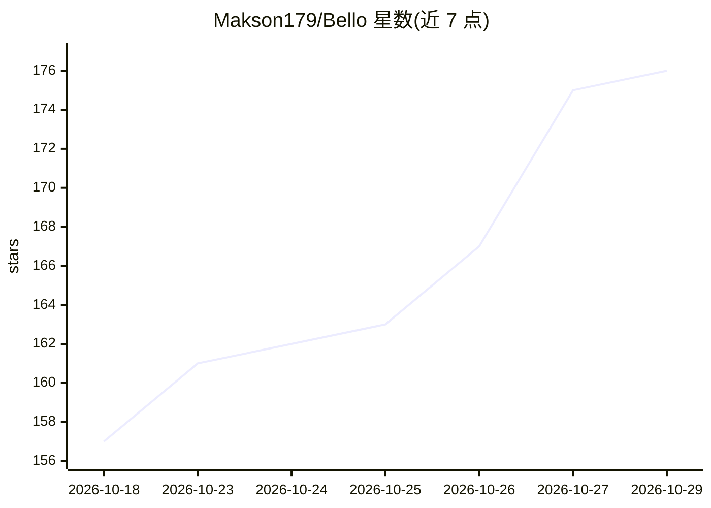

# Makson179/Bello

⭐ 176 · Python · MIT · 推送 2026-10-20 · [GitHub](https://github.com/Makson179/Bello) · 个人维护

**围绕编码 agent 的多角色编排工具：省钱并复核产出**

Bello 在编码 agent 外围挂载四个可独立开关的角色：运行时监督者（拦截高风险命令、纠偏、可重启）、完成评审者（全新上下文比对结果与任务）、对抗者（无开发历史地尝试破坏结果）以及本地运行的 ModernBERT 日志蒸馏器（压缩工具输出后再交给编码者）。各角色可用 Codex/Claude Code 订阅或 OpenAI/Anthropic/OpenRouter 等 API 供应，支持混用模型、并行子代理与 Smart Execution 并行工具调用。提供 Codex 与 Claude Code 插件，含配置建议器；README 给出多组基准数据（用量、成本、得分、耗时）。

## 筛选速览

| 维度 | 判定 | 备注 |
|---|---|---|
| AI 角色 | `ai-ecosystem` | LLM/agent 周边工具 |
| 许可风险 | `permissive` | MIT |
| 部署形态 | `None` |  |
| 模型依赖 | locked-api |  |
| 硬件要求 | — | 无带数字的原话,不猜 |
| 安装摩擦 | `low` | 无编译、无系统依赖或容器化 |
| 成熟度 | — | 结构信号不足 |

## 能力要点

- 监督者/评审者/对抗者/日志蒸馏器四角色可独立启停，各自指定模型
- 日志蒸馏器为本地运行的微调 ModernBERT（约 149M 参数，599MB 模型首跑下载）
- Smart Execution 并行执行独立工具调用，默认开启
- Goal 模式持续运行直至评审者接受原始目标；NNC 压缩历史对话（默认关闭）

## 适用场景

- 在订阅额度内降低编码 agent 的用量与成本
- 为编码任务增加完成评审与对抗测试以提升质量
- 混用多家模型订阅或 API 组建多代理编码流水线
- 让长任务在不携带全部历史的情况下继续运行

## 场景标签

`多智能体` `编码 Agent` · 领域:Agent 开发

## 证据(README 行号)

> L16: Bello runs a coding task through a coder and four optional parts: a runtime
> L100: - **Runtime supervisor.** Follows the live run, judges risky commands before
> L110: - **Log distiller.** A ModernBERT model we fine-tuned, running locally, that

## 星数曲线

2026-10-18 157 → 2026-10-29 176（+19）

---
*卡片 v1 · prompt 1.4 · 生成 2026-10-23 · 置信度 high · 依据 README sha `9829dbcec26b` · [字段定义](../../DATASET.md)*
