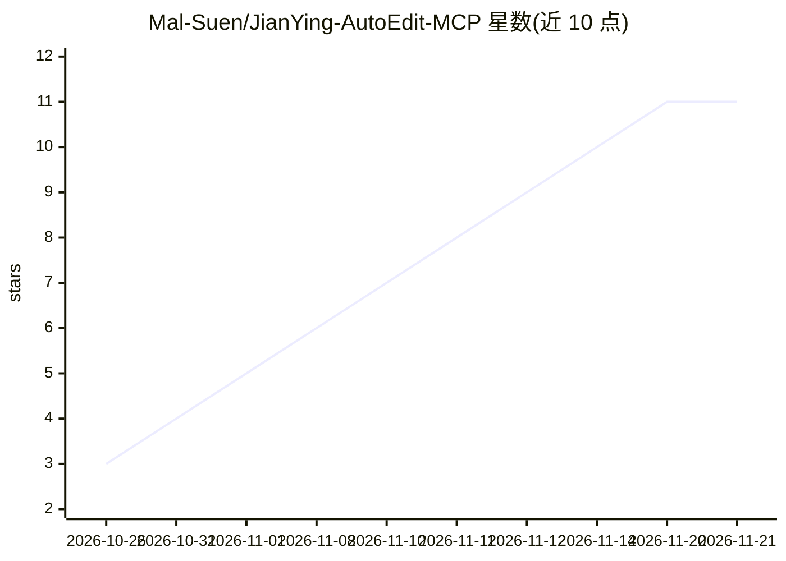

# Mal-Suen/JianYing-AutoEdit-MCP

⭐ 11 · Python · GPL-3.0 · 推送 2026-10-30 · [GitHub](https://github.com/Mal-Suen/JianYing-AutoEdit-MCP) · 个人维护 · 中文 README

**让 AI 通过 MCP 协议组装剪映草稿的服务器**

基于 pyJianYingDraft 的 MCP 服务器，提供草稿管理（创建/打开/列出/删除/摘要）、视频音频文本片段插入、SRT 字幕一键导入与分镜 JSON 一键成稿等工具；服务器进程内持有草稿对象，每次修改立即落盘到剪映草稿目录。草稿生成跨 Windows/Linux/macOS，但自动导出仅剪映 ≤6 且在 Windows 可用；加密版本剪映草稿无法打开。需 Python 3.10、mcp 1.2（钉 <2）、剪映 ≥5.9。

## 筛选速览

| 维度 | 判定 | 备注 |
|---|---|---|
| AI 角色 | `ai-enhanced` | 去掉 AI 部分产品仍成立 |
| 许可风险 | `viral` | GPL-3.0 |
| 部署形态 | `library` | 以包/库形式分发 |
| 模型依赖 | — | README 未给出锁定关系 |
| 硬件要求 | — | 无带数字的原话,不猜 |
| 安装摩擦 | `low` | 无编译、无系统依赖或容器化 |
| 成熟度 | `idea` | |

## 能力要点

- build_from_storyboard：分镜 JSON 先全量校验再生成完整草稿（视频/音频/字幕轨＋转场）
- 草稿即状态架构：每次修改立即落盘，剪映刷新可见
- open_draft 模板模式可新增轨道（暂不能向已有轨道追加片段）
- 支持 Qwen Code / Claude Code 等 stdio MCP 客户端

## 适用场景

- 对话式让 AI 建稿、加素材、导字幕
- 用一条分镜脚本一键生成完整剪映草稿
- 把已有草稿当模板批量新增字幕轨

## 场景标签

`视频生成` · 领域:内容生成

## 证据(README 行号)

> L3: 让 AI 通过 MCP 协议直接组装剪映草稿：对话式建稿、加素材、导字幕，或用一条分镜脚本一键成稿。底层 pyJianYingDraft（剪映 11.1 实测兼容）。
> L58: - Windows：全功能（草稿生成；自动导出仅剪映 ≤6）

## 星数曲线

2026-10-26 3 → 2026-11-21 11（+8）

---
*卡片 v1 · prompt 1.4 · 生成 2026-11-20 · 置信度 high · 依据 README sha `8614e1f48fa5` · [字段定义](../../DATASET.md)*
