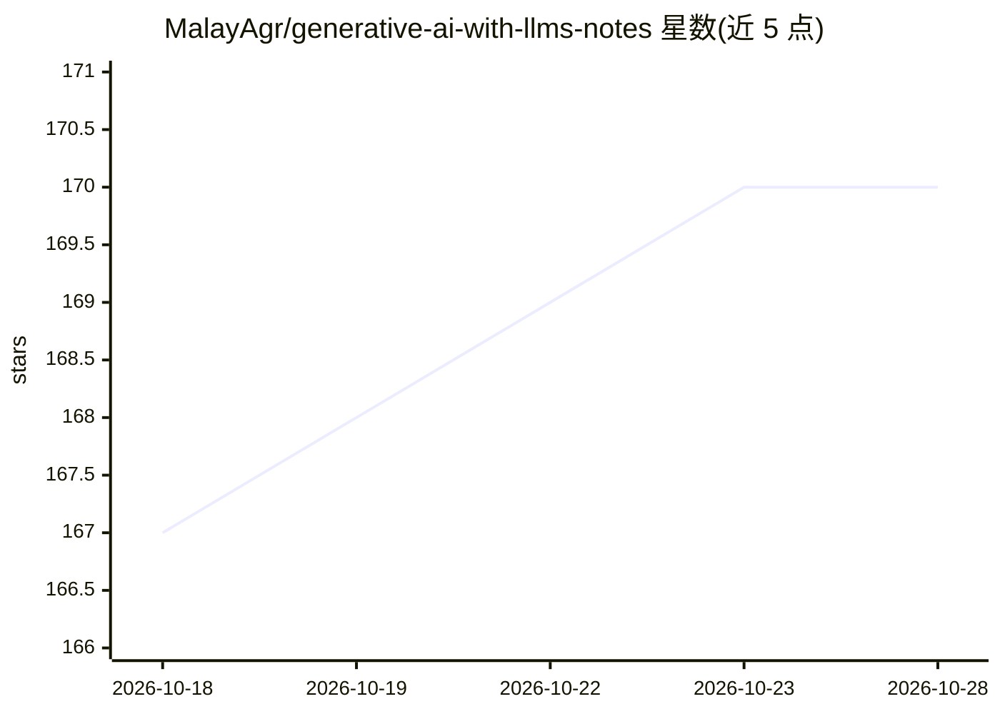

# MalayAgr/generative-ai-with-llms-notes

⭐ 170 · Jupyter Notebook · MIT · 推送 2026-02-16 · [GitHub](https://github.com/MalayAgr/generative-ai-with-llms-notes) · [官网](https://www.coursera.org/learn/generative-ai-with-llms) · 个人维护

**DeepLearning.AI 生成式 LLM 课程的笔记与代码作业合集**

收录 Coursera 上 DeepLearning.AI 课程 Generative AI with Large Language Models 的学习笔记与代码作业：两个 Jupyter 实验（基于 LoRA 的指令微调、基于 RLHF 的 LLM 对齐），以及按周组织的主题笔记，覆盖 Transformer 基础、提示工程、LLM 预训练、多 GPU 分布式训练、指令微调、模型评测指标与基准、PEFT（LoRA/Soft Prompts）和 RLHF；同内容另提供 Markdown 版本供直接在 GitHub 阅读。面向课程学习者与 LLM 入门开发者。

## 筛选速览

| 维度 | 判定 | 备注 |
|---|---|---|
| AI 角色 | `ai-knowledge` | 知识聚合/清单类 |
| 许可风险 | `permissive` | MIT |
| 部署形态 | `None` |  |
| 模型依赖 | — | README 未给出锁定关系 |
| 硬件要求 | — | 无带数字的原话,不猜 |
| 安装摩擦 | `low` | 无编译、无系统依赖或容器化 |
| 成熟度 | — | 结构信号不足 |

## 能力要点

- 两个编码作业：LoRA 指令微调与 RLHF 对齐
- 按周组织的课程笔记，覆盖 Transformer 到 RLHF
- 全部内容同时提供 Markdown 格式

## 适用场景

- 学习 DeepLearning.AI 生成式 LLM 课程时配套参考
- 查找 LoRA、PEFT、RLHF 等主题的课程笔记
- 复现课程中的指令微调与 RLHF 实验

## 场景标签

`教程课程` `微调` `强化学习` · 领域:学习与行业

## 证据(README 行号)

> L3: This repository contains detailed code examples for the course Generative AI With Large Language Models, offered by 
> L10:  - `Fine-Tuning Lab.ipynb` - Assignment which covers Instruction Fine-Tuning using LoRA.
> L11:  - `RLHF Lab.ipynb` - Assignment which covers using Reinforcement Learning From Human Feedback to align LLMs.

## 星数曲线

2026-10-18 167 → 2026-10-28 170（+3）

---
*卡片 v1 · prompt 1.4 · 生成 2026-10-22 · 置信度 high · 依据 README sha `7ad41ff7b9aa` · [字段定义](../../DATASET.md)*
