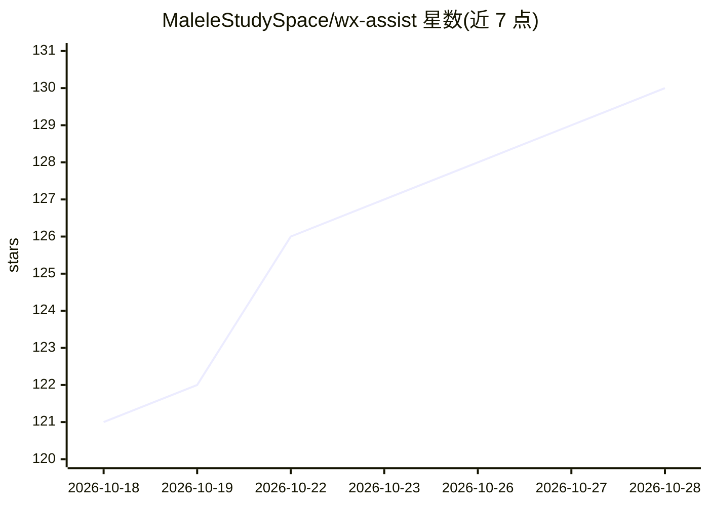

# MaleleStudySpace/wx-assist

⭐ 130 · Python · MIT · 推送 2026-10-26 · [GitHub](https://github.com/MaleleStudySpace/wx-assist) · [官网](https://wx-assist-landing.onrender.com/) · 个人维护 · 中文 README

**本地运行的微信 AI 助手：群摘要、关键词提醒、收藏/朋友圈管理**

Windows 桌面应用「摘星」，围绕微信消息处理：关键词命中即时推送到微信/QQ/飞书、多群定时合并 AI 摘要并标注待办与决定、公众号文章 AI 汇总与新文章速读推送。另提供聊天记录/收藏/朋友圈的浏览、搜索与离线导出（HTML/JSON），AI 对话基于聊天记录、收藏、公众号等上下文并可调用 RAG 语义检索精准召回；AI Agent 助手通过 ReAct 循环调用 20+ 工具，支持 MCP 与 SKILL 扩展及定时任务。核心数据处理在本机完成，RAG（ChromaDB+fastembed）100% 本地运行；使用 AI 功能时上下文按配置发送至第三方 AI API。提供完整版与去 RAG 的精简版 exe，或从 Python+React 源码启动。

## 筛选速览

| 维度 | 判定 | 备注 |
|---|---|---|
| AI 角色 | `ai-native` | 本体是模型或模型工具 |
| 许可风险 | `permissive` | MIT |
| 部署形态 | `desktop` | 安装包/桌面程序 |
| 模型依赖 | — | README 未给出锁定关系 |
| 硬件要求 | — | 无带数字的原话,不猜 |
| 安装摩擦 | `low` | 无编译、无系统依赖或容器化 |
| 成熟度 | — | 结构信号不足 |

## 能力要点

- AI Agent 助手：ReAct 推理循环，20+ 可调用工具，支持 MCP/SKILL 扩展与定时任务
- RAG 语义检索基于 ChromaDB+fastembed，模型随包分发，100% 本地运行
- 群聊定时合并摘要、关键词提醒，推送至微信/QQ/飞书
- 聊天、收藏、朋友圈可浏览、搜索并导出为离线 HTML/JSON 档案

## 适用场景

- 微信群消息太多时用定时 AI 摘要和关键词提醒筛选重点
- 给收藏、聊天记录建语义索引，用自然语言找旧内容
- 归档朋友圈和聊天记录为离线档案并让 AI 回顾
- 绑定微信/QQ/飞书，用对话让 Agent 代查消息、生成摘要

## 场景标签

`AI 助手` `语义搜索` · 领域:对话与助手

## 证据(README 行号)

> L31: - **AI 对话** — 基于聊天记录 / 收藏 / 朋友圈 / 公众号的上下文对话，支持 RAG 语义检索精准召回
> L32: - **AI Agent 智能助手** — 扫码绑定微信、QQ、飞书 与 Agent 对话，调用 20+ 工具完成状态查询、消息搜索、配置管理、摘要生成等操作，ReAct 推理循环自动拆解复杂指令

## 星数曲线

2026-10-18 121 → 2026-10-28 130（+9）

---
*卡片 v1 · prompt 1.4 · 生成 2026-10-23 · 置信度 mid · 依据 README sha `8efa2a6f380c` · [字段定义](../../DATASET.md)*
