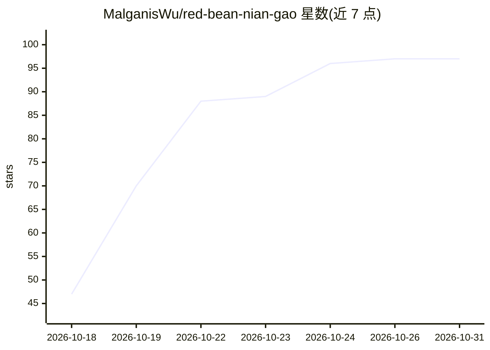

# MalganisWu/red-bean-nian-gao

⭐ 97 · TypeScript · MIT · 推送 2026-10-15 · [GitHub](https://github.com/MalganisWu/red-bean-nian-gao) · 个人维护 · 中文 README

**AI Agent 对话平台：流式对话、工具调用与完整运行审计轨迹**

由产品仓库与可嵌入运行时 SDK（red-bean-qing-tuan）两部分组成的 AI Agent 对话平台。产品侧提供会话、认证、HTTP/SSE 接口、持久化与定时任务；运行时 SDK 负责 Agent 循环、checkpoint、interrupt 与观测接缝，可嵌入其他宿主。支持子 Agent 委派、工具级人工确认屏障、启动时定死的能力图，以及基于只追加事实日志的只读轨迹审计视图。技术栈为 TypeScript、Fastify、PostgreSQL、React 19，通过 make init 从源码部署，依赖 pnpm workspace 与 runtime.lock 锁定 SDK 版本。

## 筛选速览

| 维度 | 判定 | 备注 |
|---|---|---|
| AI 角色 | `ai-native` | 本体是模型或模型工具 |
| 许可风险 | `permissive` | MIT |
| 部署形态 | `None` |  |
| 模型依赖 | — | README 未给出锁定关系 |
| 硬件要求 | — | 无带数字的原话,不猜 |
| 安装摩擦 | `low` | 无编译、无系统依赖或容器化 |
| 成熟度 | — | 结构信号不足 |

## 能力要点

- SSE 流式对话带推理块与工具调用时间线折叠
- 子 Agent 委派与 interrupt 执行屏障（人工确认前同批工具不执行）
- 只追加事实日志驱动的会话轨迹审计视图，按请求统计 token 与耗时
- 运行时 SDK 无生产依赖，可嵌入 CLI 等其他宿主

## 适用场景

- 搭建带审计轨迹的 Agent 对话应用
- 需要人工确认屏障的工具调用场景
- 通过 cron 定时触发并追踪 Agent 运行
- 复用运行时 SDK 在其他宿主中嵌入 Agent 循环

## 场景标签

`聊天机器人` `Agent 框架` · 领域:Agent 开发

## 证据(README 行号)

> L3: **一个 AI Agent 对话平台。** 支持流式对话、工具调用、子 Agent 委派、定时任务，并为每次运行留下完整审计轨迹。
> L4: 底层是一个可以嵌进任何宿主的运行时 SDK。
> L31: 2. **每次运行都能追溯。** 运行会写进一份只追加的事实日志，再以只读的轨迹视图呈现出来：跑过哪些工具、

## 星数曲线

2026-10-18 47 → 2026-10-31 97（+50）

---
*卡片 v1 · prompt 1.4 · 生成 2026-10-24 · 置信度 high · 依据 README sha `dd0ec8ad6f65` · [字段定义](../../DATASET.md)*
