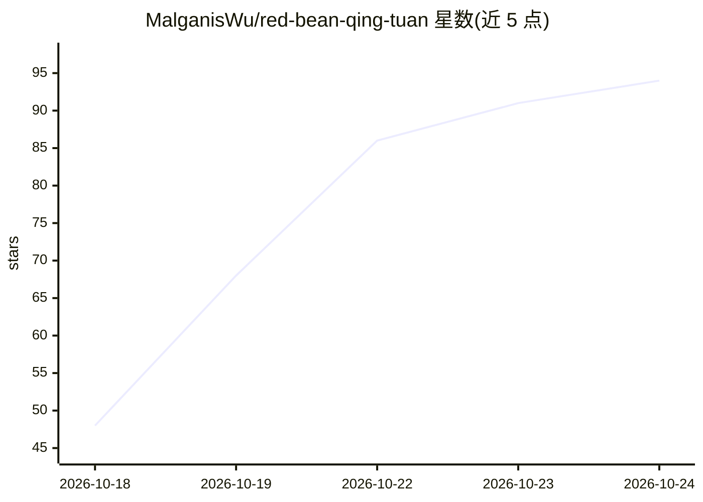

# MalganisWu/red-bean-qing-tuan

⭐ 94 · TypeScript · MIT · 推送 2026-10-15 · [GitHub](https://github.com/MalganisWu/red-bean-qing-tuan) · 个人维护 · 中文 README

**可嵌入的 TypeScript Agent Runtime：model→tool 循环与 checkpoint**

零生产依赖的 TypeScript Agent 执行层库：运行 ReAct 状态机与 model→tool 循环，提供带幂等 resume 的持久化 checkpoint、interrupt 执行屏障、Pipeline 组合、Agent 委派，以及中性 LLM adapter（默认 OpenAI-compatible 实现）与 Tracer 观测接缝。HTTP、SSE、数据库、鉴权与产品会话全部留在宿主，不提供 lease/TTL/exactly-once 等分布式语义。未发布到 npm，需从 Git 或本地构建安装，要求 Node.js >=24.9.0 <26。附框架无关契约套件供自定义 Store 验证。

## 筛选速览

| 维度 | 判定 | 备注 |
|---|---|---|
| AI 角色 | `ai-ecosystem` | LLM/agent 周边工具 |
| 许可风险 | `permissive` | MIT |
| 部署形态 | `library` | 以包/库形式分发 |
| 模型依赖 | — | README 未给出锁定关系 |
| 硬件要求 | — | 无带数字的原话,不猜 |
| 安装摩擦 | `low` | 无编译、无系统依赖或容器化 |
| 成熟度 | `idea` | |

## 能力要点

- model→tool 循环、interrupt 执行屏障与幂等 resume 的持久化 checkpoint
- 零生产依赖，产物为 ESM JavaScript 加类型声明与 source map
- 中性 LLM adapter 接口，默认实现为 OpenAI-compatible
- 默认安全的内置工具（私网/回环地址拒绝、路径逃逸防护）

## 适用场景

- 把 agent 执行层嵌入自己的 HTTP 服务而不引入框架假定
- 需要 interrupt 审批与可恢复 checkpoint 的工具调用流程
- 自建 Store 并用契约套件验证并发/fencing 语义

## 场景标签

`Agent 框架` · 领域:Agent 开发

## 证据(README 行号)

> L16: `red-bean-qing-tuan` 只做执行层，别的一概不管。它运行 model→tool 循环，通过**你提供的**
> L102: |`red-bean-qing-tuan/llm`|中性 LLM adapter 接口与 OpenAI-compatible 默认实现|

## 星数曲线

2026-10-18 48 → 2026-10-24 94（+46）

---
*卡片 v1 · prompt 1.4 · 生成 2026-10-23 · 置信度 mid · 依据 README sha `11c26b5dd0d0` · [字段定义](../../DATASET.md)*
