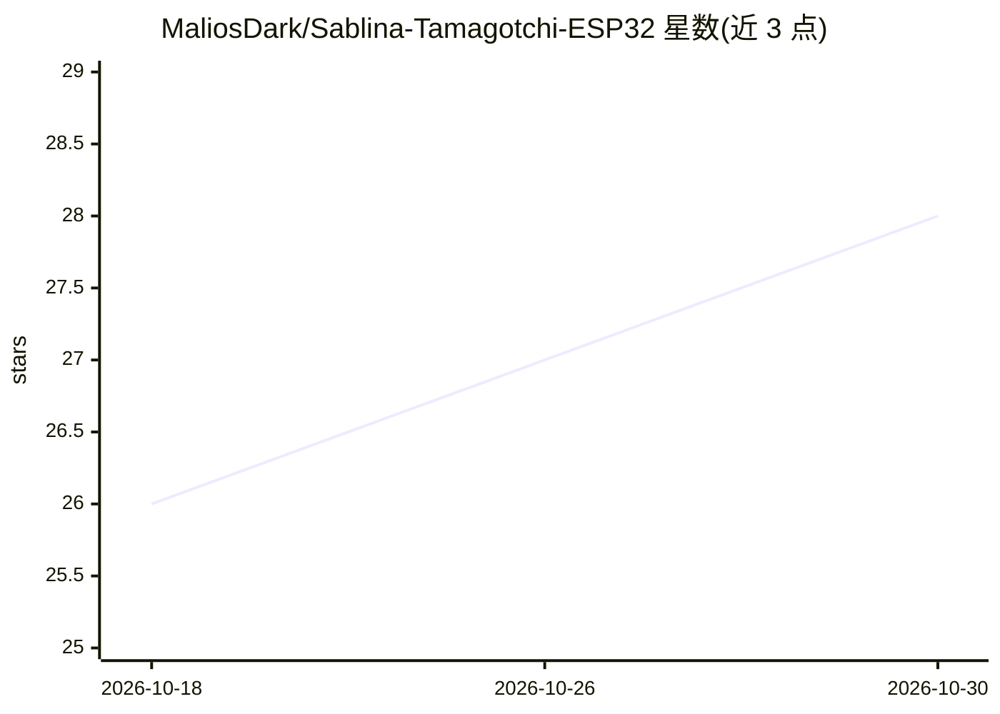

# MaliosDark/Sablina-Tamagotchi-ESP32

⭐ 28 · C · GPL-2.0 · 推送 2026-05-04 · [GitHub](https://github.com/MaliosDark/Sablina-Tamagotchi-ESP32) · [官网](https://sablina.opensable.com) · 个人维护

**ESP32-S3 电子宠物机，兼作 WiFi 安全审计工具**

基于 ESP32-S3 的双用途设备固件项目：完整电子宠物玩法（喂食/清洁/睡眠/BLE 邻居社交与亲密度系统）叠加 WiFi 审计功能，包括 AP 扫描、监听、deauth、WPA 四次握手捕获与 PMKID 提取，导出 hc22000 供 hashcat 离线破解。提供 Arduino 与 ESP-IDF 两套固件变体及浏览器模拟器；IDF 版内置 llama2.c 驱动的 TinyStories 260K 离线 LLM 生成角色化想法，ReAct 循环中工具选择由确定性优先级选择器完成。另含 Telegram 机器人远程控制，可接入 OpenAI 兼容 API。仅限授权渗透测试用途。

## 筛选速览

| 维度 | 判定 | 备注 |
|---|---|---|
| AI 角色 | `ai-enhanced` | 去掉 AI 部分产品仍成立 |
| 许可风险 | `viral` | GPL-2.0 |
| 部署形态 | `self-host` | docker 或自建部署 |
| 模型依赖 | local-ok | 支持本地模型 |
| 硬件要求 | — | 无带数字的原话,不猜 |
| 安装摩擦 | `low` | 无编译、无系统依赖或容器化 |
| 成熟度 | — | 结构信号不足 |

## 能力要点

- WiFi 审计五模式（SCAN/MONITOR/DEAUTH/HANDSHAKE/PMKID），导出 hc22000 供 hashcat 使用
- 设备端 TinyStories 260K 离线 LLM 生成角色想法，无 WiFi/云端依赖
- BLE 设备间社交记忆与亲密度系统，NVS 持久化
- Telegram 内联键盘远程控制，支持 Ollama/OpenAI/Groq 等多种 OpenAI 兼容后端

## 适用场景

- 在钥匙链大小的设备上养电子宠物并进行授权 WiFi 渗透测试
- 无需硬件时用浏览器模拟器体验全部功能
- 通过 Telegram 远程照看宠物并获取 AI WiFi 目标建议
- 两台设备 BLE 靠近时自动聊天并积累亲密度

## 场景标签

`网络安全` · 领域:学习与行业

## 证据(README 行号)

> L75: Sablina is a dual-purpose ESP32-S3 device: a fully-featured virtual pet **and** a WiFi security auditing tool inspi

## 星数曲线

2026-10-18 26 → 2026-10-30 28（+2）

---
*卡片 v1 · prompt 1.4 · 生成 2026-10-26 · 置信度 mid · 依据 README sha `02d0f55c724f` · [字段定义](../../DATASET.md)*
