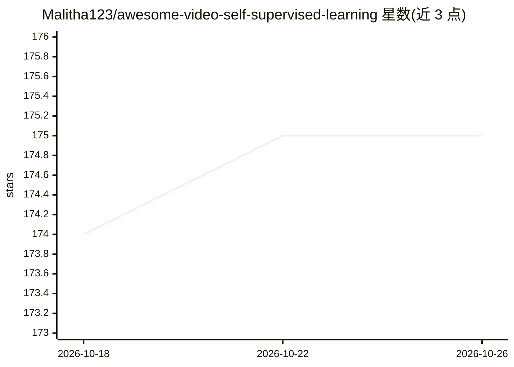

# Malitha123/awesome-video-self-supervised-learning

⭐ 175 · HTML · 推送 2026-10-05 · [GitHub](https://github.com/Malitha123/awesome-video-self-supervised-learning) · 组织维护

**视频自监督学习论文策展清单：面向研究者的方法收录**

源自综述论文《Unifying Video Self-Supervised Learning across Families of Tasks: A Survey》的持续维护清单，收录视频自监督学习方法条目，按发表年份组织，覆盖表征学习、综述与基准评测等板块；条目含论文链接及部分代码/项目页链接，另提供可搜索的镜像网站。面向视频理解方向的科研人员，接受社区 PR 补充，不提供代码或安装运行方式。

## 筛选速览

| 维度 | 判定 | 备注 |
|---|---|---|
| AI 角色 | `ai-knowledge` | 知识聚合/清单类 |
| 许可风险 | `none` | — |
| 部署形态 | `None` |  |
| 模型依赖 | — | README 未给出锁定关系 |
| 硬件要求 | — | 无带数字的原话,不猜 |
| 安装摩擦 | `low` | 无编译、无系统依赖或容器化 |
| 成熟度 | — | 结构信号不足 |

## 能力要点

- 条目按发表年份组织，含论文/代码/项目页链接
- 源自 2024 年综述论文并由作者持续更新
- 提供可搜索的镜像网站（含论文检索与仓库统计）

## 适用场景

- 查找视频自监督学习的最新方法与基准评测论文
- 按年份追踪该领域的发展脉络
- 为下游任务（动作识别、视频检索等）寻找可复用的预训练方法与代码

## 场景标签

`精选清单` `科研工具` · 领域:学习与行业

## 证据(README 行号)

> L8: This repository is originating from our survey paper "**Unifying Video Self-Supervised Learning across Families of T
> L17: This repository contains a collection of state-of-the-art self-supervised learning in video approaches for various 

## 星数曲线

2026-10-18 174 → 2026-10-26 175（+1）

---
*卡片 v1 · prompt 1.4 · 生成 2026-10-22 · 置信度 high · 依据 README sha `bd6bd9e3e1cc` · [字段定义](../../DATASET.md)*
