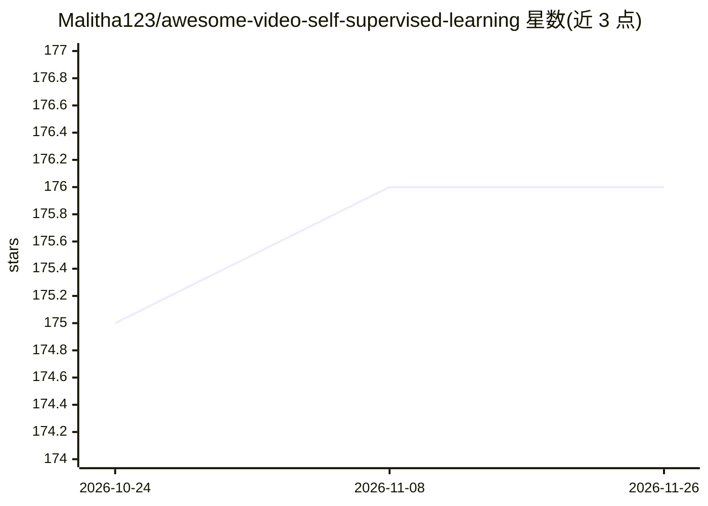

# Malitha123/awesome-video-self-supervised-learning

⭐ 176 · HTML · 推送 2026-11-03 · [GitHub](https://github.com/Malitha123/awesome-video-self-supervised-learning) · 组织维护

**视频自监督学习论文清单：按年份整理方法与综述资源**

源自作者综述论文《Unifying Video Self-Supervised Learning across Families of Tasks: A Survey》的文献清单仓库：按发表年份组织视频自监督学习（VideoSSL）方法条目，另设 Surveys 与 Benchmarking 板块，覆盖动作识别、视频检索等下游任务相关论文。每条含作者、出处与论文/代码链接，并提供可搜索网站版本，支持通过 pull request 协作补充。无安装运行步骤，以浏览查阅为主。

## 筛选速览

| 维度 | 判定 | 备注 |
|---|---|---|
| AI 角色 | `ai-knowledge` | 知识聚合/清单类 |
| 许可风险 | `none` | — |
| 部署形态 | `None` |  |
| 模型依赖 | — | README 未给出锁定关系 |
| 硬件要求 | — | 无带数字的原话,不猜 |
| 安装摩擦 | `low` | 无编译、无系统依赖或容器化 |
| 成熟度 | — | 结构信号不足 |

## 能力要点

- 按发表年份组织 VideoSSL 方法条目（含 2026 年 CVPR/ICLR/ECCV 论文）
- 设 Surveys 与 Benchmarking 两个独立板块
- 多数条目附论文、代码或项目页链接
- 提供带搜索与统计功能的配套网站

## 适用场景

- 入门视频自监督学习时按年份查阅方法脉络
- 调研 VideoSSL 综述与基准评测论文
- 查找某篇 SSL 方法的论文与代码入口

## 场景标签

`精选清单` · 领域:学习与行业

## 证据(README 行号)

> L6: # `Awesome Video Self-Supervised Learning (Video SSL / VideoSSL)`
> L17: This repository contains a collection of state-of-the-art self-supervised learning in video approaches for various 
> L37: ### Contents

## 星数曲线

2026-10-24 175 → 2026-11-26 176（+1）

---
*卡片 v1 · prompt 1.4 · 生成 2026-11-26 · 置信度 high · 依据 README sha `e2707f05aa8a` · [字段定义](../../DATASET.md)*
