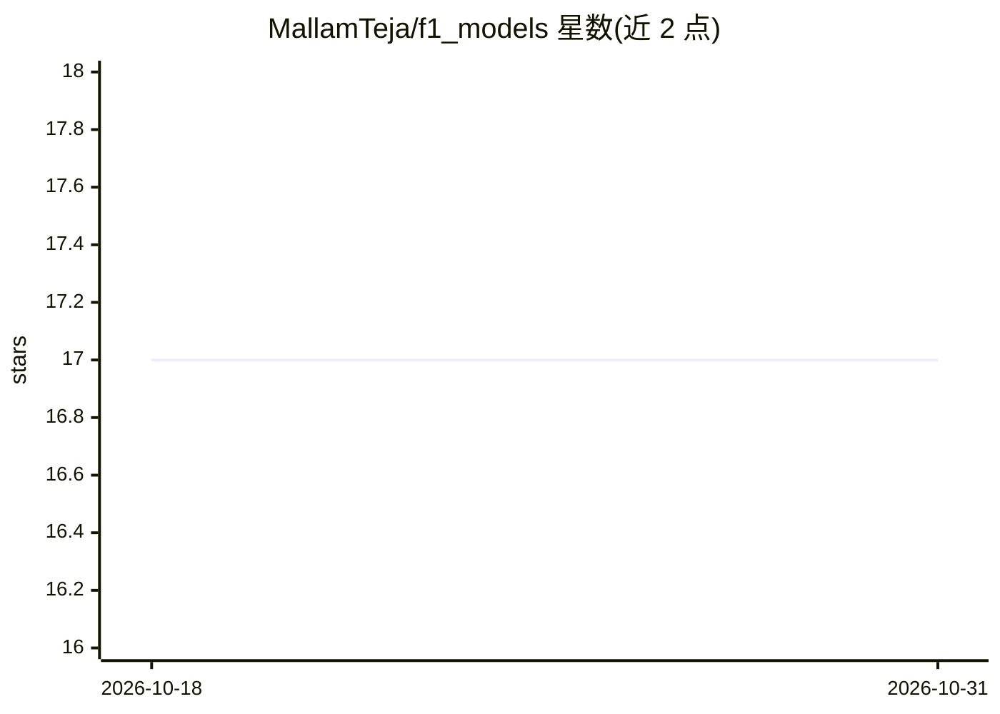

# MallamTeja/f1_models

⭐ 17 · Python · MIT · 推送 2026-10-25 · [GitHub](https://github.com/MallamTeja/f1_models) · [官网](https://f1predictor.tech) · 个人维护

**F1 四站大奖赛单圈节奏预测的 FastAPI 服务**

基于 FastAPI 的推理服务，为阿布扎比、卡塔尔、美国（奥斯汀）、墨西哥四条赛道各提供一个预训练模型，输入排位赛时间、干净空气正赛节奏、车队强度与天气参数，输出预测单圈节奏（秒）。模型为 GradientBoostingRegressor/XGBRegressor（joblib 工件），含输入校验（圈时间窗、正赛慢于排位否则 422）。训练脚本从 FastF1 与 OpenWeather 拉取数据，需网络与 API key，且重训结果不可逐位复现。提供 Docker 多阶段镜像（模型内嵌约 1.5MB、离线运行）、pytest 回归测试与 CI/CD 流水线。

## 筛选速览

| 维度 | 判定 | 备注 |
|---|---|---|
| AI 角色 | `ai-native` | 本体是模型或模型工具 |
| 许可风险 | `permissive` | MIT |
| 部署形态 | `self-host` | docker 或自建部署 |
| 模型依赖 | — | README 未给出锁定关系 |
| 硬件要求 | — | 无带数字的原话,不猜 |
| 安装摩擦 | `low` | 无编译、无系统依赖或容器化 |
| 成熟度 | — | 结构信号不足 |

## 能力要点

- 四条赛道各一个预训练模型，从 models/ 目录加载
- 输入校验：圈时间需在合理窗口内且正赛节奏慢于排位
- 多阶段 Docker 镜像，模型内嵌约 1.5MB，运行时无需网络与密钥
- pytest 固定输入预测值回归测试，依赖变更改变输出会失败 CI

## 适用场景

- 通过 REST API 预测 F1 车手在四条赛道的单圈节奏
- 用 Docker 或 uvicorn 快速本地部署推理服务
- 基于 FastF1 数据重训各赛道模型

## 场景标签

`数据分析` · 领域:效率与自动化

## 证据(README 行号)

> L7: A FastAPI service that predicts a driver's race pace (seconds per lap) for four Grand Prix circuits — **Abu Dhabi, Q
> L20: |Mexico|`training/6.py`|`models/mexico_model.joblib`|GradientBoostingRegressor + SimpleImputer|
> L22: |Qatar|`training/10-3.py`|`models/qatar_model.joblib`|XGBRegressor (monotone constraints) + SimpleImputer|

## 星数曲线

2026-10-18 17 → 2026-10-31 17（+0）

---
*卡片 v1 · prompt 1.4 · 生成 2026-10-30 · 置信度 mid · 依据 README sha `bfcbce661b2b` · [字段定义](../../DATASET.md)*
