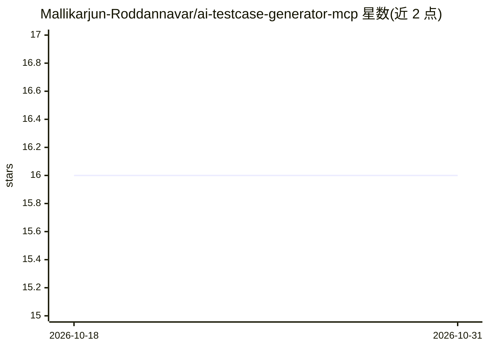

# Mallikarjun-Roddannavar/ai-testcase-generator-mcp

⭐ 16 · TypeScript · MIT · 推送 2026-10-29 · [GitHub](https://github.com/Mallikarjun-Roddannavar/ai-testcase-generator-mcp) · 个人维护

**面向 QA 工程师的 MCP 服务器：从 API 元数据生成测试用例 Excel**

基于 TypeScript 的 Model Context Protocol(MCP) 服务器，供 QA 工程师在 Claude Desktop、Cline、Hermes Agent 等 MCP 客户端中调用。提供 generate_tests_excel 工具：输入端点、HTTP 方法、载荷与补充上下文，经提示词驱动 LLM 生成正向、负向与边界用例，并导出为含 Test Name、Pre-Condition、Steps、Expected Result 列的 Excel 测试计划，文件与日志写入配置的 WORK_DIR。LLM 可配置为 Groq、OpenAI 或 Anthropic，需自备 API key。安装方式为 git clone 后 npm install、npm run build，需 Node 环境。

## 筛选速览

| 维度 | 判定 | 备注 |
|---|---|---|
| AI 角色 | `ai-native` | 本体是模型或模型工具 |
| 许可风险 | `permissive` | MIT |
| 部署形态 | `library` | 以包/库形式分发 |
| 模型依赖 | — | README 未给出锁定关系 |
| 硬件要求 | — | 无带数字的原话,不猜 |
| 安装摩擦 | `low` | 无编译、无系统依赖或容器化 |
| 成熟度 | — | 结构信号不足 |

## 能力要点

- generate_tests_excel 工具：端点元数据→正向/负向/边界测试用例
- 输出 Excel 测试计划（Test Name/Pre-Condition/Steps/Expected Result 列）
- 可配置 LLM 后端（Groq/OpenAI/Anthropic）
- stdio 传输，兼容 Claude Desktop、Cline、Hermes Agent，附带 MCP Inspector 调试脚本

## 适用场景

- 在 Claude Desktop 等 MCP 客户端里为 API 端点生成测试计划
- 为 QA 团队快速产出正向、负向与边界用例并导出 Excel
- 基于 Swagger 式端点描述批量补充自动化测试用例

## 场景标签

 · 领域:软件测试/LLM 工具

## 证据(README 行号)

> L3: An **Model Context Protocol(MCP) server** that generates comprehensive **API test plans** (positive, negative, and b
> L14: - 📝 Tool: `generate_tests_excel`
> L20: - 🧠 **Prompt-driven test generation** with configurable LLM (Groq, OpenAI, Anthropic).

## 星数曲线

2026-10-18 16 → 2026-10-31 16（+0）

---
*卡片 v1 · prompt 1.4 · 生成 2026-10-30 · 置信度 high · 依据 README sha `b85e4a58f37b` · [字段定义](../../DATASET.md)*
