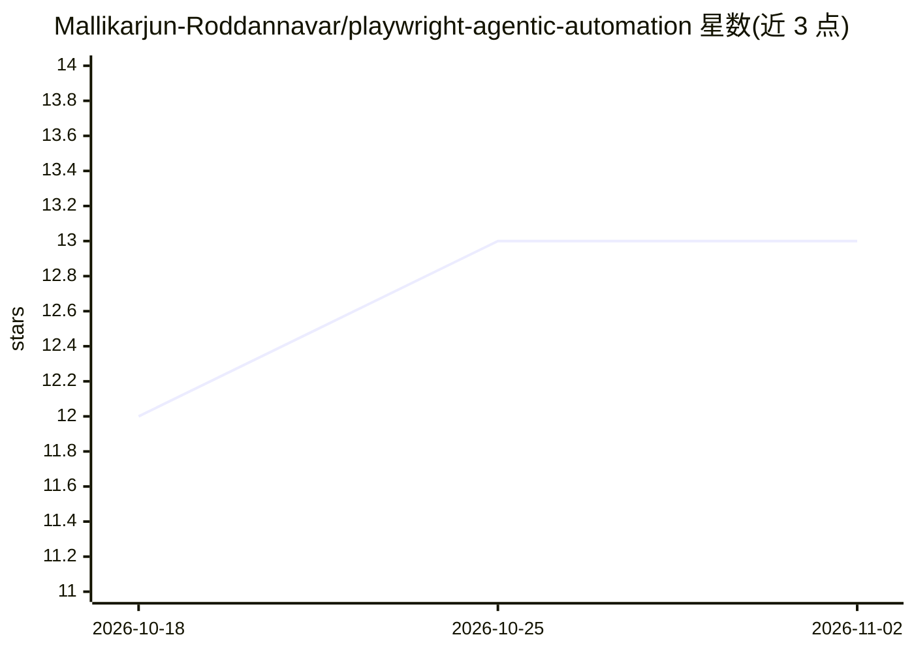

# Mallikarjun-Roddannavar/playwright-agentic-automation

⭐ 13 · TypeScript · MIT · 推送 2026-10-08 · [GitHub](https://github.com/Mallikarjun-Roddannavar/playwright-agentic-automation) · 个人维护

**将 AI 编码代理纳入 QA 纪律的 Playwright 测试框架与知识模式**

面向使用 Codex、Claude Code 等编码代理的开发者：提供本地 Markdown 形式的代码库 second brain、AGENTS.md 项目规则与 SKILL.md 任务技能三类构件，使代理在理解功能、规划测试、诊断失败与安全修复时遵循证据驱动流程。内含一个完整的 Playwright + TypeScript UI/API 示例框架（Page Objects、fixtures、多角色会话、日志与报告），通过 npm 安装运行。无模型密钥、SDK、向量库或托管服务依赖；笔记为纯 Markdown，无自动新鲜度检查。

## 筛选速览

| 维度 | 判定 | 备注 |
|---|---|---|
| AI 角色 | `ai-ecosystem` | LLM/agent 周边工具 |
| 许可风险 | `permissive` | MIT |
| 部署形态 | `library` | 以包/库形式分发 |
| 模型依赖 | — | README 未给出锁定关系 |
| 硬件要求 | — | 无带数字的原话,不猜 |
| 安装摩擦 | `low` | 无编译、无系统依赖或容器化 |
| 成熟度 | — | 结构信号不足 |

## 能力要点

- 本地 Markdown second brain + AGENTS.md 规则 + SKILL.md 技能三构件模式
- 完整 Playwright UI/API 示例框架（Page Objects、API services、日志、报告）
- 失败诊断策略：先判定测试错误/应用缺陷/环境问题再决定是否允许修复
- 无需模型密钥、向量库或托管 AI 平台

## 适用场景

- 让我的编码代理先理解项目再改测试代码
- 为 Playwright 项目建立代理可遵循的测试纪律与规则
- 让代理分析失败并给出证据分类而非直接改测试
- 作为模式模板移植到自己项目的 AGENTS.md/SKILL.md 体系

## 场景标签

`浏览器自动化` `提示工程` · 领域:Agent 开发

## 证据(README 行号)

> L11: `playwright-agentic-automation` turns AI coding agents, such as Codex and Claude Code, into evidence-driven Playwri
> L13: A real Playwright UI/API framework puts the pattern into practice. Playwright provides browser and test capability.

## 星数曲线

2026-10-18 12 → 2026-11-02 13（+1）

---
*卡片 v1 · prompt 1.4 · 生成 2026-10-31 · 置信度 high · 依据 README sha `ecc3c7762c96` · [字段定义](../../DATASET.md)*
