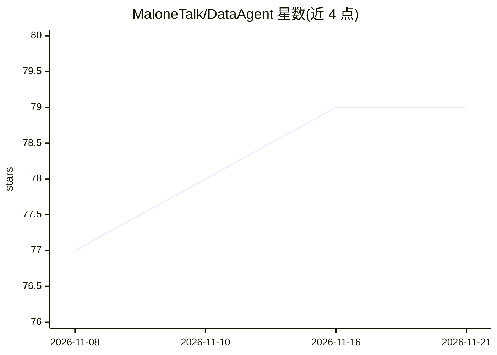

# MaloneTalk/DataAgent

⭐ 79 · Java · AGPL-3.0 · 推送 2026-11-20 · [GitHub](https://github.com/MaloneTalk/DataAgent) · 个人维护 · 中文 README

**面向业务人员的自然语言数据分析智能体（Text-to-SQL）**

用中文自然语言提问，通过 LLM + ReAct 工具调用生成 SQL 并在目标数据库执行，支持 Python 统计分析（相关性、回归、分布检验）与交互图表。核心机制是语义层：以'域'组织表，由 LLM 推理业务问题所属域并主动选表，不使用向量检索与 embedding 索引。数据源层基于 JDBC 标准接口，内置八种数据库类型支持，但默认发布包仅内置 MySQL 驱动，其他数据库需添加驱动依赖并重新构建。支持多模型提供商切换、角色与表列级数据权限、OpenTelemetry 可观测性，并可通过 CLI 与 Skill 目录接入 Claude Code 等外部 Agent。

## 筛选速览

| 维度 | 判定 | 备注 |
|---|---|---|
| AI 角色 | `ai-native` | 本体是模型或模型工具 |
| 许可风险 | `viral` | AGPL-3.0 |
| 部署形态 | `library` | 以包/库形式分发 |
| 模型依赖 | local-ok | 支持本地模型 |
| 硬件要求 | — | 无带数字的原话,不猜 |
| 安装摩擦 | `medium` | 含编译或系统依赖之一 |
| 成熟度 | `idea` | |

## 能力要点

- 语义层用 LLM 域推理替代向量召回，零 embedding 索引维护
- JDBC 多数据源：MySQL/PostgreSQL/Oracle/ClickHouse/SQL Server/达梦/OceanBase/SQLite
- 查询结果自动执行 Python 统计分析（相关性、回归、分布检验）
- OpenTelemetry 全链路 trace，支持 Jaeger/Tempo/SigNoz/Langfuse 等后端

## 适用场景

- 用中文直接向数据库提问并获得图表与分析
- 在同一会话中跨多个数据源查询
- 把问数能力作为只读工具接入 Claude Code 等外部 Agent

## 场景标签

`数据分析` · 领域:效率与自动化

## 证据(README 行号)

> L5: **Data Agent** 是一个面向业务人员的自然语言数据分析智能体：你用中文提问，它把问题理解成 SQL 或 Python 分析代码、执行查询与统计计算，并以流式对话的方式把结果与分析返回给你。它内置**语义层**，把"业务语
> L16: - **自然语言查数**：基于 LLM + ReAct 工具调用，把自然语言转为 SQL 并在目标库执行，全程流式输出。
> L18: - **多模型可切换**：内置 OpenAI 兼容接口 / Ollama / 通义 DashScope / Anthropic 等提供商，换底座模型不影响已沉淀的业务知识。

## 星数曲线

2026-11-08 77 → 2026-11-21 79（+2）

---
*卡片 v1 · prompt 1.4 · 生成 2026-11-18 · 置信度 mid · 依据 README sha `098a00a0ebef` · [字段定义](../../DATASET.md)*
