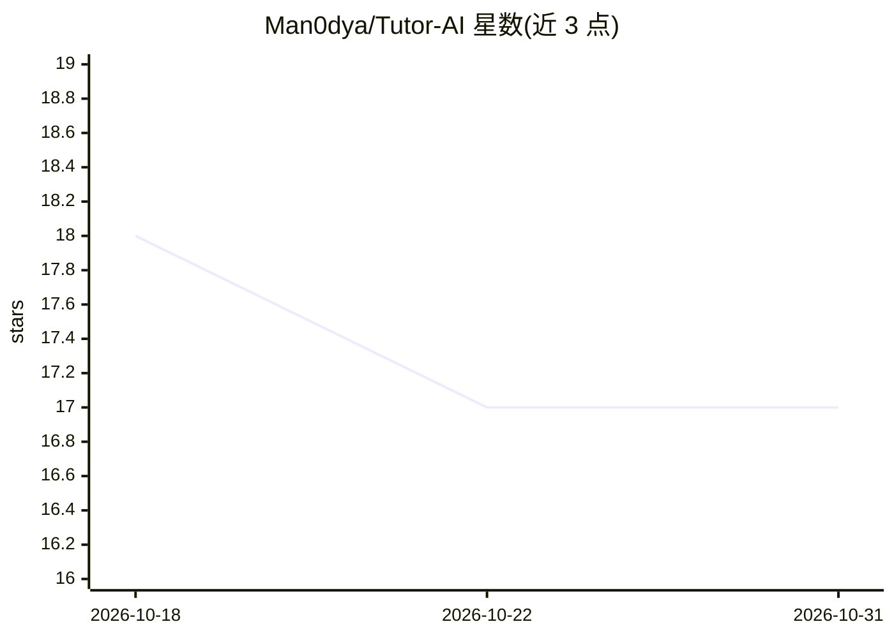

# Man0dya/Tutor-AI

⭐ 17 · Python · Apache-2.0 · 推送 2026-10-20 · [GitHub](https://github.com/Man0dya/Tutor-AI) · 个人维护

**多智能体 AI 辅导系统：生成学习内容、题集与反馈**

FastAPI 后端 + React (Vite/TS/Chakra UI) 前端的全栈 AI 辅导应用：按主题/难度/目标生成结构化课程内容，基于 Bloom 分级生成题集（MCQ 归一化为 4 选项），提交答案后给出带解释的反馈，并在仪表盘跟踪进度。AI 能力由 Google Gemini 提供，MongoDB 存储数据，可选 Atlas Search + Vector Search 做语义缓存复用以减少 LLM 调用；含 JWT 认证、PII 检测与脱敏、Stripe 计费与套餐限额。面向学生自学者，开发者可本地部署（需 Python 3.11、Node 18+、MongoDB 与 Gemini API key）。

## 筛选速览

| 维度 | 判定 | 备注 |
|---|---|---|
| AI 角色 | `ai-native` | 本体是模型或模型工具 |
| 许可风险 | `permissive` | Apache-2.0 |
| 部署形态 | `library` | 以包/库形式分发 |
| 模型依赖 | — | README 未给出锁定关系 |
| 硬件要求 | — | 无带数字的原话,不猜 |
| 安装摩擦 | `low` | 无编译、无系统依赖或容器化 |
| 成熟度 | — | 结构信号不足 |

## 能力要点

- 结构化课程生成与 Bloom/难度感知题集生成
- 答案提交后给出解释与学习建议的反馈
- Atlas Vector Search 语义缓存：相似主题复用已有内容以减少 LLM 调用
- PII 检测脱敏、内容审核与 Stripe 套餐计费

## 适用场景

- 按自己的主题和难度生成课程笔记与练习题
- 提交答案获得带解释的反馈并跟踪学习进度
- 班级/团队共学场景下复用相似内容降低生成成本

## 场景标签

`多智能体` · 领域:Agent 开发

## 证据(README 行号)

> L3: An AI tutoring system with a FastAPI backend and a modern React (Vite + TypeScript + Chakra UI) frontend. It creates
> L64: - **Backend**: FastAPI in `server/` with MongoDB (Motor), JWT auth, and multi-agent logic in `agents/`

## 星数曲线

2026-10-18 18 → 2026-10-31 17（-1）

---
*卡片 v1 · prompt 1.4 · 生成 2026-10-30 · 置信度 high · 依据 README sha `329ab12246cf` · [字段定义](../../DATASET.md)*
