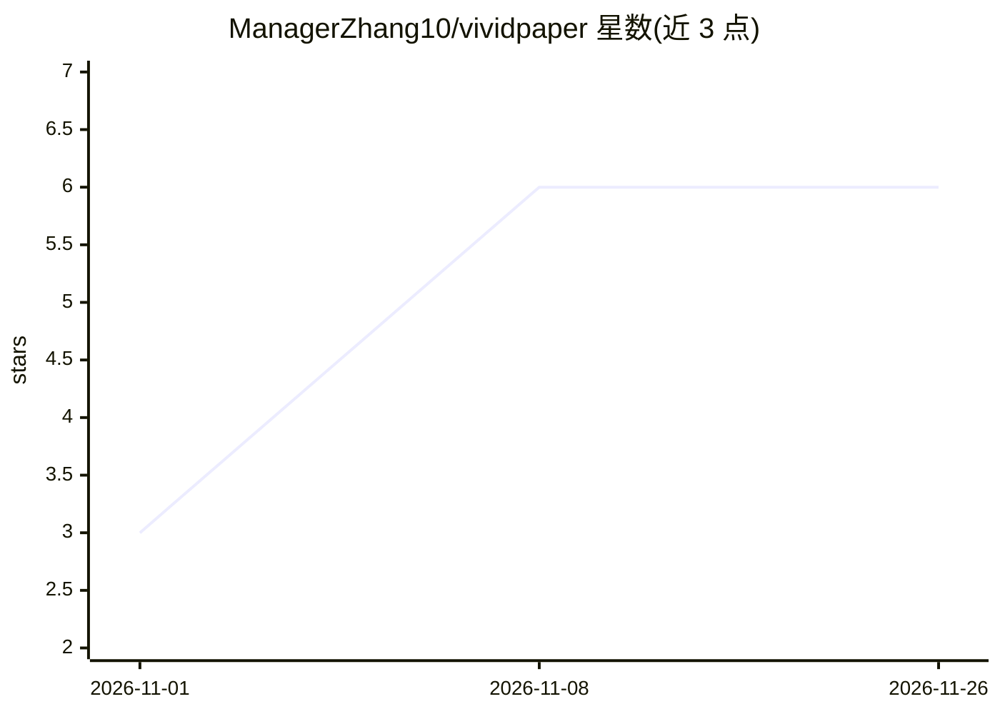

# ManagerZhang10/vividpaper

⭐ 6 · JavaScript · NOASSERTION · 推送 2026-11-07 · [GitHub](https://github.com/ManagerZhang10/vividpaper) · [官网](https://managerzhang10.github.io/vividpaper/) · 个人维护 · 中文 README

**给 AI 编程助手的论文动效解读页生成 skill**

以 Claude Code / Codex skill 形式安装的工具：向 agent 提交一篇 arXiv 或 PDF 论文后，按 SKILL.md 流程生成单文件 HTML 动效解读页，包含 5–8 幕画面与字幕，输出前经无头 Chrome 自查出界与字号问题。提供 Flash 版（自带 canvas 引擎）与标准版（HyperFrames + GSAP，需 Node ≥ 22，可导出 mp4）两个版本，配音用 edge-tts 免费中文男声、无需 API key。依赖 Python 3、pymupdf 与本机 Chrome。

## 筛选速览

| 维度 | 判定 | 备注 |
|---|---|---|
| AI 角色 | `ai-native` | 本体是模型或模型工具 |
| 许可风险 | `none` | NOASSERTION |
| 部署形态 | `library` | 以包/库形式分发 |
| 模型依赖 | — | README 未给出锁定关系 |
| 硬件要求 | — | 无带数字的原话,不猜 |
| 安装摩擦 | `medium` | 含编译或系统依赖之一 |
| 成熟度 | — | 结构信号不足 |

## 能力要点

- 将 arXiv/PDF 论文生成带配音的单文件 HTML 动效解读页
- edge-tts 一键配音，字幕与动画跟随语音时间轴同步
- 无头 Chrome 自动自查出界、字号、字幕与画面静止问题
- 标准版可经 build.py 导出带音轨的 mp4（需 ffmpeg）

## 适用场景

- 把要读的论文做成可分享的动画讲解页
- 离线阅读带配音的论文解读（单文件 HTML）
- 为自己的 agent 扩展论文可视化讲解能力

## 场景标签

`科研工具` · 领域:学习与行业

## 证据(README 行号)

> L5: **张指导出品。** 给你的 AI 编程助手（Claude Code、Codex 等）装上这个 skill，丢给它一篇论文，它会做出一个**动效解读页**：一个双击就能在浏览器里打开的 HTML 文件，用论文自己的图加上动画，一幕一
> L71: 它会按 SKILL.md 的流程走：先看标准版装没装 → 拉原文和原图 → 定一个主线问题和一个贯穿全片的例子 → 拆成 5–8 幕 → 裁论文原图、写动效 → 打包成单文件 HTML → 无头 Chrome 自查（出界、字太小、

## 星数曲线

2026-11-01 3 → 2026-11-26 6（+3）

---
*卡片 v1 · prompt 1.4 · 生成 2026-11-20 · 置信度 mid · 依据 README sha `b53091c47928` · [字段定义](../../DATASET.md)*
