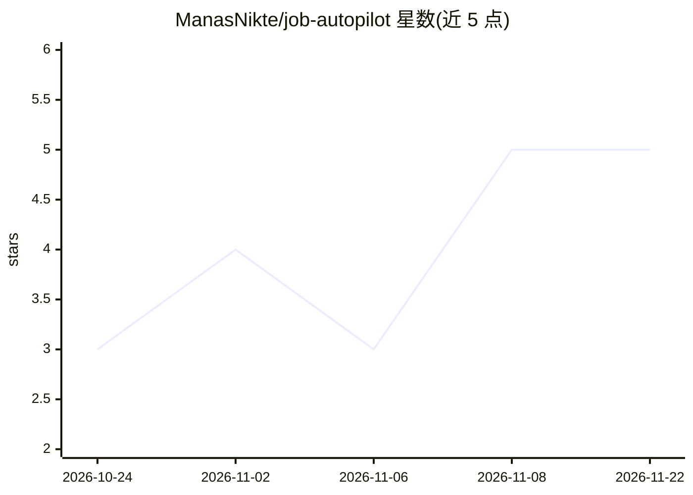

# ManasNikte/job-autopilot

⭐ 5 · Python · 推送 2026-11-11 · [GitHub](https://github.com/ManasNikte/job-autopilot) · [官网](https://manasnikte.github.io/job-autopilot/) · 个人维护

**为在美留学生本地运行 AI 求职申请流水线**

在本机运行（127.0.0.1:5055）的求职申请流水线：每日两次抓取支持 H-1B 签证的美国职位，用 Claude 按 master prompt 中的背景与规则筛选；对匹配职位生成定制一页简历与求职信 PDF 并自动校验，Chrome 扩展自动填充申请表。需要人工判断的事项进入 Needs you 收件箱；从 Gmail/Outlook/Apple Mail 只读读取雇主回复，由 Claude 分类为 received/rejected/assessment/interview/offer 并自动更新职位状态。提供本地仪表盘与可自托管的在线仪表盘（GitHub Pages + Supabase），含用量读取、到达限额自动暂停等机制。

## 筛选速览

| 维度 | 判定 | 备注 |
|---|---|---|
| AI 角色 | `ai-native` | 本体是模型或模型工具 |
| 许可风险 | `none` | — |
| 部署形态 | `library` | 以包/库形式分发 |
| 模型依赖 | locked-api |  |
| 硬件要求 | — | 无带数字的原话,不猜 |
| 安装摩擦 | `low` | 无编译、无系统依赖或容器化 |
| 成熟度 | — | 结构信号不足 |

## 能力要点

- Claude 按用户 master prompt 筛选 H-1B 职位并生成简历/求职信 PDF
- 只读读取 Gmail/Outlook/Apple Mail，Claude 将申请邮件分类并自动更新职位状态
- Chrome 扩展自动填充申请表，人工判断项集中到 Needs you 收件箱
- 在线仪表盘可自托管（GitHub Pages + Supabase），支持手机远程触发运行

## 适用场景

- 在美留学生批量追踪支持 H-1B 的职位并自动生成申请材料
- 从邮箱自动分类申请回复、跟踪 rejection/assessment/offer 状态
- 手机远程查看投递进度并触发本地任务

## 场景标签

`工作流自动化` `网页抓取` `浏览器自动化` `AI 写作` · 领域:效率与自动化

## 证据(README 行号)

> L7: **A local, AI-powered job-application pipeline.** Twice a day it finds new US roles at companies that
> L194: - **Only application emails reach Claude.** A rule filter drops job alerts, newsletters, and personal mail.

## 星数曲线

2026-10-24 3 → 2026-11-22 5（+2）

---
*卡片 v1 · prompt 1.4 · 生成 2026-11-21 · 置信度 mid · 依据 README sha `30e34b732dd7` · [字段定义](../../DATASET.md)*
