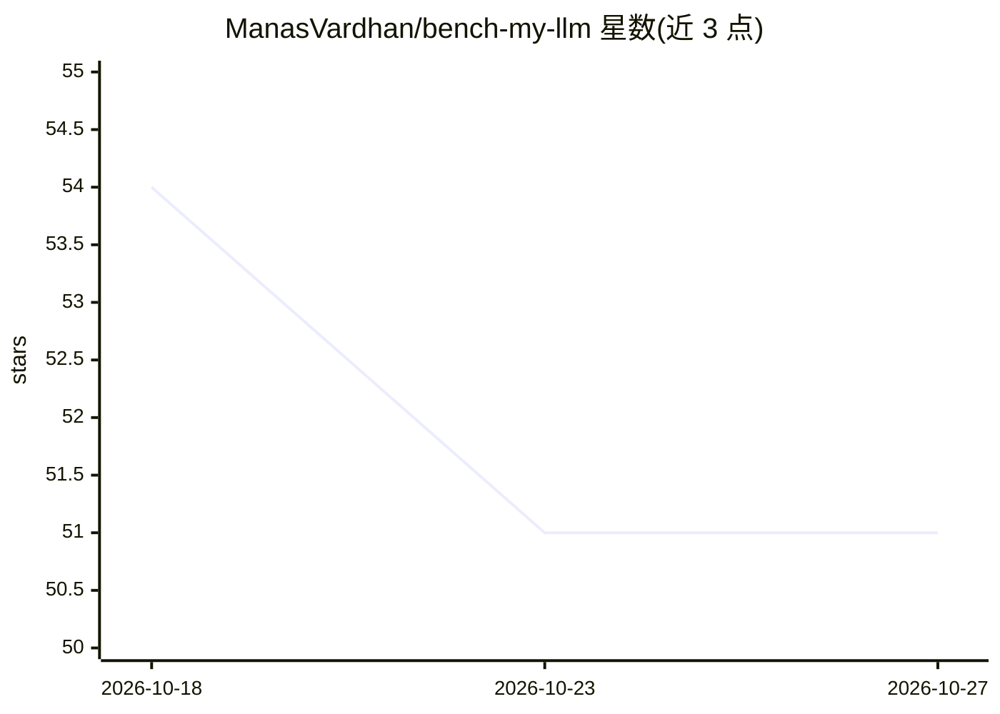

# ManasVardhan/bench-my-llm

⭐ 51 · Python · MIT · 推送 2026-09-08 · [GitHub](https://github.com/ManasVardhan/bench-my-llm) · 个人维护

**面向开发者的 LLM 基准测试 CLI：测延迟、成本与质量**

通过 pip 安装的命令行工具，指向任意 OpenAI 兼容 API 即可测量 LLM 的 TTFT、tokens/s、p50/p95/p99 延迟、成本估算与基于参考答案的质量评分，支持模型并排对比。内置推理/编码/创作/事实四类提示词套件，可从 JSON/YAML 加载自定义套件，并通过注册表安装、更新、发布可共享套件包。结果可导出 JSON/CSV/Markdown/HTML，提供历史趋势、按元数据过滤/对比/分组与成本加权排行榜；自动检测本地 Ollama 服务，可集成到 GitHub Actions。需要 Python 3.10+。

## 筛选速览

| 维度 | 判定 | 备注 |
|---|---|---|
| AI 角色 | `ai-ecosystem` | LLM/agent 周边工具 |
| 许可风险 | `permissive` | MIT |
| 部署形态 | `library` | 以包/库形式分发 |
| 模型依赖 | local-ok | 支持本地模型 |
| 硬件要求 | — | 无带数字的原话,不猜 |
| 安装摩擦 | `low` | 无编译、无系统依赖或容器化 |
| 成熟度 | — | 结构信号不足 |

## 能力要点

- TTFT、tokens/s、p50/p95/p99 延迟与成本估算等指标测量
- 任意 OpenAI 兼容 API 均可测试，含 Ollama 自动检测（--ollama 免 URL/key）
- 结果导出 JSON/CSV/Markdown/HTML，含自包含 HTML 报告
- 运行元数据记录、过滤、对比、分组与历史趋势追踪

## 适用场景

- 在多个模型间对比延迟、成本与质量以辅助选型
- 跟踪模型或端点随时间变化的性能趋势
- 把 LLM 基准测试纳入 CI 流程

## 场景标签

`模型评测` · 领域:评测与运维

## 证据(README 行号)

> L12: Point `bench-my-llm` at any OpenAI-compatible API and get latency, throughput, cost, and quality metrics in seconds
> L23: - 🔌 **Any OpenAI-compatible API** - OpenAI, Anthropic, Ollama, vLLM, Together, and more

## 星数曲线

2026-10-18 54 → 2026-10-27 51（-3）

---
*卡片 v1 · prompt 1.4 · 生成 2026-10-25 · 置信度 high · 依据 README sha `9931fa8f31d3` · [字段定义](../../DATASET.md)*
