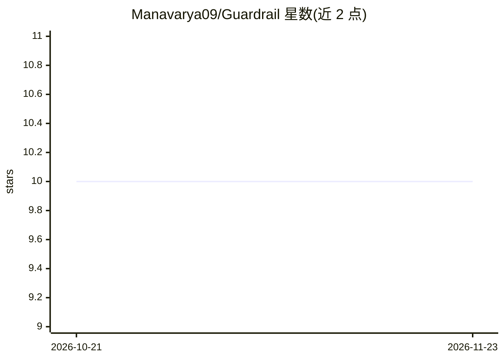

# Manavarya09/Guardrail

⭐ 10 · TypeScript · MIT · 推送 2026-04-28 · [GitHub](https://github.com/Manavarya09/Guardrail) · [官网](https://guardrail-ai-self.vercel.app) · 个人维护

**面向 AI 生成代码的安全扫描与自动修复 CLI 工具**

以 CLI 形式运行的代码扫描器：内置 30 条规则，覆盖安全（硬编码密钥、SQL 注入、XSS、JWT 误用等 15 条）、AI 代码生成反模式（幻觉 import、占位符代码等 11 条）、质量与性能四类；支持 AST 自动修复、git diff 扫描、pre-commit hook、baseline 渐进采纳，输出 md/HTML/SARIF/JSON 报告，并提供 GitHub Action 与面向 Claude Code 的 MCP 插件。npm 全局安装，零配置即可使用，MIT 许可。

## 筛选速览

| 维度 | 判定 | 备注 |
|---|---|---|
| AI 角色 | `ai-enhanced` | 去掉 AI 部分产品仍成立 |
| 许可风险 | `permissive` | MIT |
| 部署形态 | `library` | 以包/库形式分发 |
| 模型依赖 | — | README 未给出锁定关系 |
| 硬件要求 | — | 无带数字的原话,不猜 |
| 安装摩擦 | `low` | 无编译、无系统依赖或容器化 |
| 成熟度 | — | 结构信号不足 |

## 能力要点

- 30 条内置规则，其中 11 条针对 AI 代码生成的反模式（幻觉 import、占位符代码等）
- AST 自动修复引擎，输出统一 diff
- 7 个命令：scan/fix/diff/baseline/hook 等，支持 git diff 增量扫描
- 提供 GitHub Action、SARIF 报告与 Claude Code MCP 插件（guardrail_scan/fix/list_rules）

## 适用场景

- CI/PR 流程中扫描 AI 生成代码的安全问题
- 作为 pre-commit hook 阻断含 critical/high 问题的提交
- 用 baseline 模式只报新增问题、逐步治理存量代码
- 生成 md 报告交由 Claude/ChatGPT 引导修复

## 场景标签

`代码审查` · 领域:编码与开发

## 证据(README 行号)

> L5: Scan and fix security issues, performance problems, bad patterns, and AI-specific anti-patterns -- before they ship.
> L136: ### AI-Codegen (11 rules) -- unique to Guardrail
> L209:   mcp/        Model Context Protocol server (Claude Code plugin)

## 星数曲线

2026-10-21 10 → 2026-11-23 10（+0）

---
*卡片 v1 · prompt 1.4 · 生成 2026-11-20 · 置信度 high · 依据 README sha `0e04717cb4fe` · [字段定义](../../DATASET.md)*
