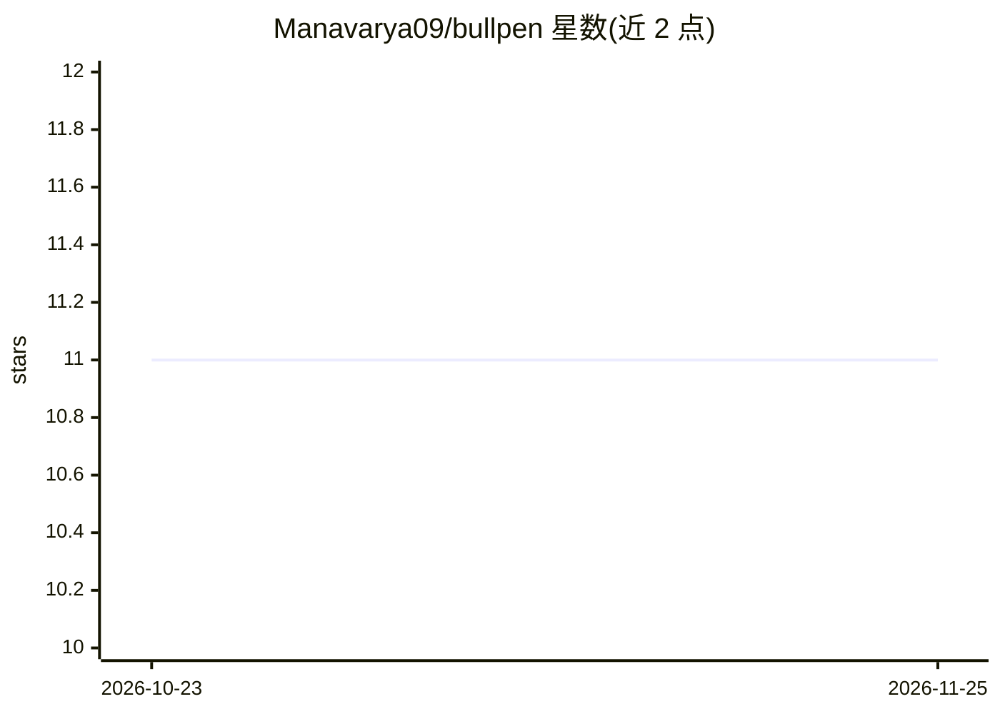

# Manavarya09/bullpen

⭐ 11 · JavaScript · MIT · 推送 2026-06-26 · [GitHub](https://github.com/Manavarya09/bullpen) · 个人维护

**面向 Claude Code 的 64 个具名 AI 工程角色提示词插件**

以 Claude Code 插件形式发布的 agent 提示词集合：64 个具名角色（如 Atlas 主导、Rune 设计、Forge 后端、Bastion 安全、Sage 教练），每个角色带版本固定的默认值、反模式表、验证清单与交接条件。提供三种调用方式（/bullpen 委派、/<role> 直呼、自然语言 hook 路由）、基于仓库内 JSON 文件的按项目记忆，以及本地 hook 实现的 ASCII 激活卡与状态行提示。仅支持 macOS/Linux（WSL 可用），依赖 Node 18+。

## 筛选速览

| 维度 | 判定 | 备注 |
|---|---|---|
| AI 角色 | `ai-ecosystem` | LLM/agent 周边工具 |
| 许可风险 | `permissive` | MIT |
| 部署形态 | `None` |  |
| 模型依赖 | — | README 未给出锁定关系 |
| 硬件要求 | — | 无带数字的原话,不猜 |
| 安装摩擦 | `low` | 无编译、无系统依赖或容器化 |
| 成熟度 | — | 结构信号不足 |

## 能力要点

- 64 个具名角色，含反模式表、2025 版本固定默认值与验证清单
- 记忆以普通 JSON 存于仓库内，按项目隔离，可随 git 共享
- 三种调用入口：总调度命令、按角色命令、自然语言 hook 路由
- 本地 hook 驱动的 ASCII 激活卡与状态行提示

## 适用场景

- 在 Claude Code 中按角色拆分前端/后端/安全/DBA 任务
- 让 agent 在项目仓库中沉淀可复用的记忆与约定
- 团队间通过 git 共享一套统一的 agent 工作流

## 场景标签

`多智能体` `提示工程` `编码 Agent` · 领域:Agent 开发

## 证据(README 行号)

> L39: - **Three ways to talk to them.** `/bullpen <task>` (Atlas delegates), `/<role> <task>` (call a specific person), o
> L40: - **They remember — and the memory lives in your repo.** `<your-project>/.bullpen/memory.json`. Per-project. Plain 
> L46: /plugin marketplace add Manavarya09/bullpen

## 星数曲线

2026-10-23 11 → 2026-11-25 11（+0）

---
*卡片 v1 · prompt 1.4 · 生成 2026-11-19 · 置信度 high · 依据 README sha `ae0fbc43188a` · [字段定义](../../DATASET.md)*
