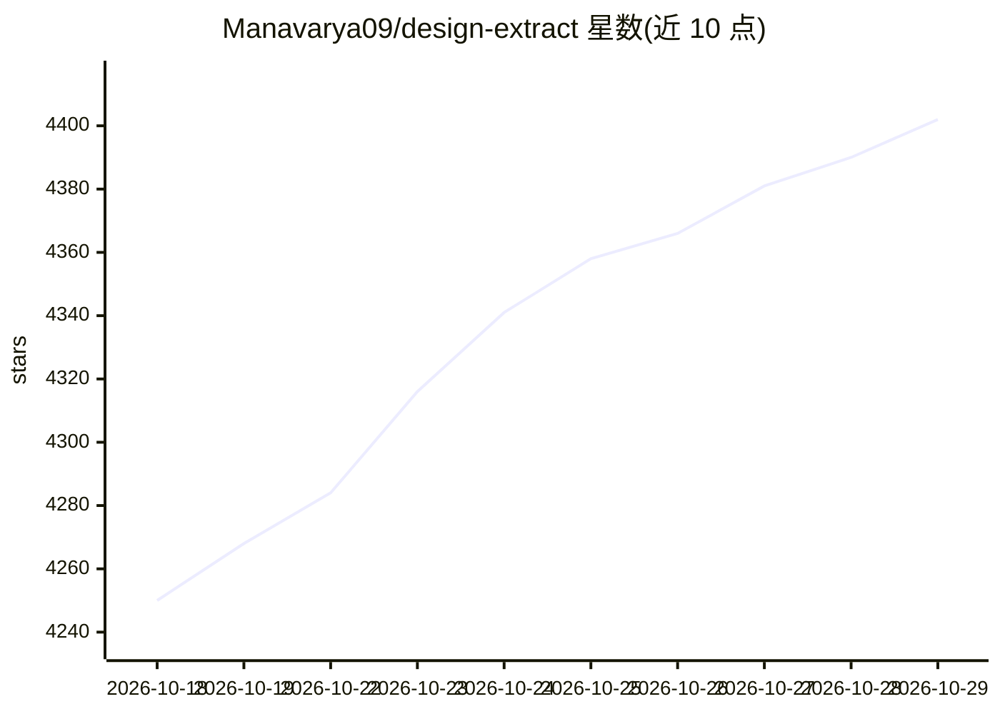

# Manavarya09/design-extract

⭐ 4,402 · HTML · MIT · 推送 2026-10-23 · [GitHub](https://github.com/Manavarya09/design-extract) · [官网](https://www.designlang.app) · 个人维护

**从任意网站提取完整设计系统的 CLI：DTCG tokens、保真度评分与多平台输出**

面向开发者与设计工程师的 npm CLI（designlang）：用 headless Chromium 读取网站的调色、字体、间距、动效等，输出 W3C DTCG tokens（primitive/semantic/composite）、Tailwind 配置、Figma 变量、shadcn 主题、组件 TypeScript 存根等 17+ 文件；支持全站爬取合成单一规范系统、OKLab 合并近似色、0-100 一致性评分，以及以 30 个确定性特征对设计做 DNA 定位与克隆保真度度量。可作 Claude Code 插件（11 个斜杠命令）、MCP 服务器与 agent skill 使用；--smart 可选接 Atlas Cloud/OpenAI/Anthropic API，默认路径零依赖、无需 API key、确定性输出。需 Node 环境，另需一次性 install-browser 安装 Chromium 或使用已装的 Chrome。

## 筛选速览

| 维度 | 判定 | 备注 |
|---|---|---|
| AI 角色 | `ai-enhanced` | 去掉 AI 部分产品仍成立 |
| 许可风险 | `permissive` | MIT |
| 部署形态 | `library` | 以包/库形式分发 |
| 模型依赖 | locked-api |  |
| 硬件要求 | — | 无带数字的原话,不猜 |
| 安装摩擦 | `low` | 无编译、无系统依赖或容器化 |
| 成熟度 | — | 结构信号不足 |

## 能力要点

- 每次运行输出 17+ 文件：DTCG tokens、Tailwind 配置、Figma 变量、shadcn 主题、组件 .tsx 存根等
- 全站爬取合成单一去重设计系统，按覆盖率选举 token 并输出 0-100 一致性评分
- 克隆保真度度量：视觉像素 diff + 动效比对，给出修正计划，可作 CI 门禁
- 附带 MCP 服务器与 Claude Code 插件（11 个斜杠命令），可作为 agent skill 安装

## 适用场景

- 从竞品或参考网站提取设计 tokens，直接导入 Tailwind/Figma/组件代码
- 给网站设计系统做量化评分、一致性审计与全站漂移检测
- 度量自己克隆的页面与原站的视觉与动效保真度并按计划修正
- 在 Claude Code/Cursor 等 agent 中通过 MCP/插件调用设计提取能力

## 场景标签

`网页抓取` · 领域:效率与自动化

## 证据(README 行号)

> L224: npx designlang https://stripe.com --smart
> L168: `npm install` no longer downloads a browser, so it works in CI, Docker and
> L229: - Existing `OPENAI_API_KEY` and `ANTHROPIC_API_KEY` flows keep working unchanged
> L237: |`*-design-language.md`|19-section markdown — feed any LLM to recreate the design|

## 星数曲线

2026-10-18 4,250 → 2026-10-29 4,402（+152）

---
*卡片 v1 · prompt 1.4 · 生成 2026-10-20 · 置信度 high · 依据 README sha `109f4f963ac1` · [字段定义](../../DATASET.md)*
