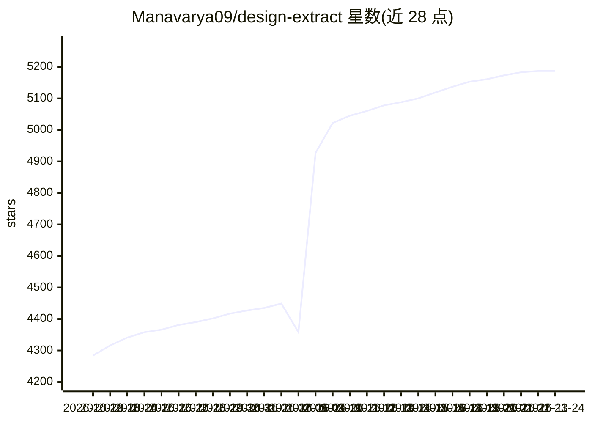

# Manavarya09/design-extract

⭐ 5,187 · HTML · MIT · 推送 2026-11-18 · [GitHub](https://github.com/Manavarya09/design-extract) · [官网](https://www.designlang.app) · 个人维护

**一条命令提取任意网站设计系统，输出 DTCG 令牌与多平台代码**

designlang（仓库 design-extract）是一个 Node.js CLI：给定 URL 后读取页面的调色板、字体、间距、动效等设计要素，输出 W3C DTCG 令牌、Tailwind 配置、Figma Variables、shadcn/ui 变量、React 组件存根等 17+ 个文件。附带子命令：site 全站爬取合并去重、fidelity 对克隆与原站做像素与动效评分、dna 将设计映射到 30 个可测特征、slop 泛化度打分、verify-ui 多宽度品牌一致性检查。通过 MCP server 与 Claude Code 插件、agent skill 形式接入 AI 编辑器。需 Node.js 20+，无需账号与 API key；--smart 模式可经 Atlas Cloud 调用大模型。

## 筛选速览

| 维度 | 判定 | 备注 |
|---|---|---|
| AI 角色 | `ai-enhanced` | 去掉 AI 部分产品仍成立 |
| 许可风险 | `permissive` | MIT |
| 部署形态 | `library` | 以包/库形式分发 |
| 模型依赖 | — | README 未给出锁定关系 |
| 硬件要求 | — | 无带数字的原话,不猜 |
| 安装摩擦 | `low` | 无编译、无系统依赖或容器化 |
| 成熟度 | — | 结构信号不足 |

## 能力要点

- 输出 W3C DTCG 令牌（primitive+semantic+composite）与 17+ 文件包
- MCP server 与 Claude Code 插件（11 个 slash 命令）、40+ agent skill
- site 子命令按覆盖率合并全站令牌，OKLab 合并近似色
- fidelity 命令对克隆做像素与动效双维评分并输出修正计划

## 适用场景

- 从竞品或参考网站提取令牌直接生成 Tailwind/Figma 主题
- 用 fidelity 命令量化自己克隆站与原站的差距
- 在 CI 中用 verify-ui 检查页面是否偏离品牌规范
- 把 DESIGN.md 喂给 AI 编辑器以复刻目标设计风格

## 场景标签

`网页抓取` · 领域:效率与自动化

## 证据(README 行号)

> L1: designlang: read any site’s design system, as tokens for Tailwind, Figma and your AI editor. npx designlang stripe.c
> L177: npx skills add Manavarya09/design-extract   # as an agent skill (40+ agents)
> L232: `designlang --smart` can now use Atlas Cloud through its OpenAI-compatible chat API, so low-confidence classifiers

## 星数曲线

2026-10-22 4,284 → 2026-11-24 5,187（+903）

---
*卡片 v1 · prompt 1.4 · 生成 2026-11-23 · 置信度 high · 依据 README sha `2777323151e2` · [字段定义](../../DATASET.md)*
