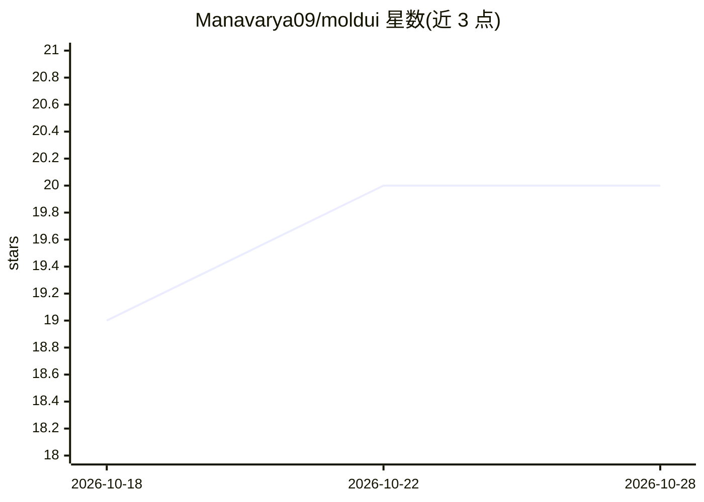

# Manavarya09/moldui

⭐ 20 · JavaScript · MIT · 推送 2026-06-20 · [GitHub](https://github.com/Manavarya09/moldui) · [官网](https://moldui.vercel.app) · 个人维护

**面向已有代码库的浏览器可视化拖拽编辑器，由 Claude 改写源码**

以 Node.js 代理包裹本地开发服务器并注入编辑器覆盖层：点击选择、拖拽移动/交换、8 向缩放、行内文本编辑、样式面板、图层面板与 Cmd+K 元素搜索，修改先以 CSS 覆盖即时生效；保存时把变更压缩为批次文件写入 .moldui/，再以 headless 方式 spawn claude 按 stream-json 格式读取批次并对真实源文件做最小化修改，由框架 HMR 重载。自动应用需安装 Claude Code，批次格式也支持 Cursor、Copilot、Gemini CLI 等手动应用。兼容 Next.js、Vite、Svelte、Django、Rails 等多框架。

## 筛选速览

| 维度 | 判定 | 备注 |
|---|---|---|
| AI 角色 | `ai-enhanced` | 去掉 AI 部分产品仍成立 |
| 许可风险 | `permissive` | MIT |
| 部署形态 | `library` | 以包/库形式分发 |
| 模型依赖 | — | README 未给出锁定关系 |
| 硬件要求 | — | 无带数字的原话,不猜 |
| 安装摩擦 | `low` | 无编译、无系统依赖或容器化 |
| 成熟度 | — | 结构信号不足 |

## 能力要点

- 代理注入覆盖层，直接编辑已有代码库，无框架锁定
- 变更压缩为批次文件，spawn claude headless 自动改写源码
- 图层面板、Cmd+K 搜索、Alt 拖拽交换、视口帧等设计工具式编辑
- 批次格式跨 AI 助手，Claude Code 之外可手动应用

## 适用场景

- 在浏览器里拖拽微调真实项目里的组件样式与文案
- 用自然语言让 AI 修改当前页面并自动提交变更
- 不换技术栈，给现有 Next.js/Django/Rails 项目加可视化编辑层

## 场景标签

`编码 Agent` · 领域:编码与开发

## 证据(README 行号)

> L69: **And the AI part.** When you click Save:
> L73: 3. moldui spawns `claude` headless with `--output-format stream-json`
> L131: The auto-apply feature needs **Claude Code** installed to run headlessly. But the batch format is AI-agnostic — an

## 星数曲线

2026-10-18 19 → 2026-10-28 20（+1）

---
*卡片 v1 · prompt 1.4 · 生成 2026-10-28 · 置信度 high · 依据 README sha `72d9e57bc074` · [字段定义](../../DATASET.md)*
