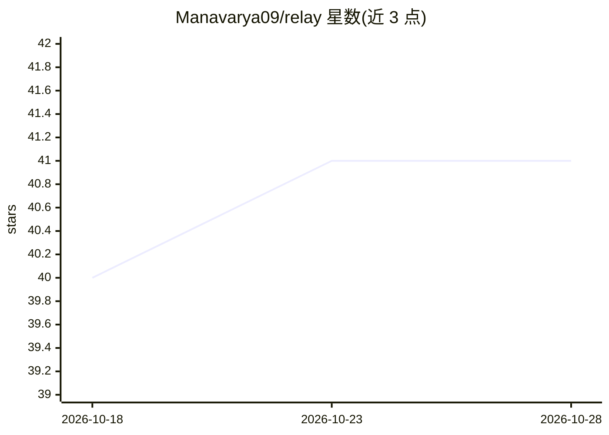

# Manavarya09/relay

⭐ 41 · Rust · MIT · 推送 2026-09-15 · [GitHub](https://github.com/Manavarya09/relay) · [官网](https://manavarya09.github.io/relay/) · 个人维护

**给 Claude Code 用户的 CLI：触发限流时把会话上下文交接给其他编码 agent**

Rust 编写的 CLI 工具，读取 Claude Code 的 .jsonl 会话转录文件，提取对话轮次、工具调用、错误、决策与 git 状态，按相关性评分压缩上下文，扫描泄露的密钥并估算 API 成本后，将完整上下文交给 Codex、Gemini、Aider、Ollama 等 8 个内置适配器之一；失败时按优先级链式切换。支持守护进程模式自动检测限流、TOML+shell 脚本插件系统自定义 agent、本地 SQLite 记录分析数据。通过 npm 安装预编译二进制。

## 筛选速览

| 维度 | 判定 | 备注 |
|---|---|---|
| AI 角色 | `ai-ecosystem` | LLM/agent 周边工具 |
| 许可风险 | `permissive` | MIT |
| 部署形态 | `library` | 以包/库形式分发 |
| 模型依赖 | local-ok | 支持本地模型 |
| 硬件要求 | — | 无带数字的原话,不猜 |
| 安装摩擦 | `low` | 无编译、无系统依赖或容器化 |
| 成熟度 | — | 结构信号不足 |

## 能力要点

- 读取 Claude .jsonl 转录并按相关性评分压缩上下文
- 8 个内置 agent 适配器，失败时按优先级链式切换
- 交接前扫描 API key/令牌/私钥等泄露密钥并拦截
- 守护进程模式（relay watch）自动检测限流并交接，另支持插件自定义 agent

## 适用场景

- Claude Code 限流后无缝切换到 Codex/Gemini/Ollama 继续 coding 会话
- 不想手动重新解释上下文时一键交接会话状态
- 通过插件系统接入团队内部自建 agent

## 场景标签

`编码 Agent` · 领域:编码与开发

## 证据(README 行号)

> L8: **When Claude Code hits its rate limit, another agent picks up exactly where you left off.**
> L52: Relay reads Claude's actual `.jsonl` session transcript -- every conversation turn, tool call, file edit, error, de
> L112: |Ollama|Local API|REST call to local model with retry|

## 星数曲线

2026-10-18 40 → 2026-10-28 41（+1）

---
*卡片 v1 · prompt 1.4 · 生成 2026-10-25 · 置信度 high · 依据 README sha `22eaf64a28f8` · [字段定义](../../DATASET.md)*
