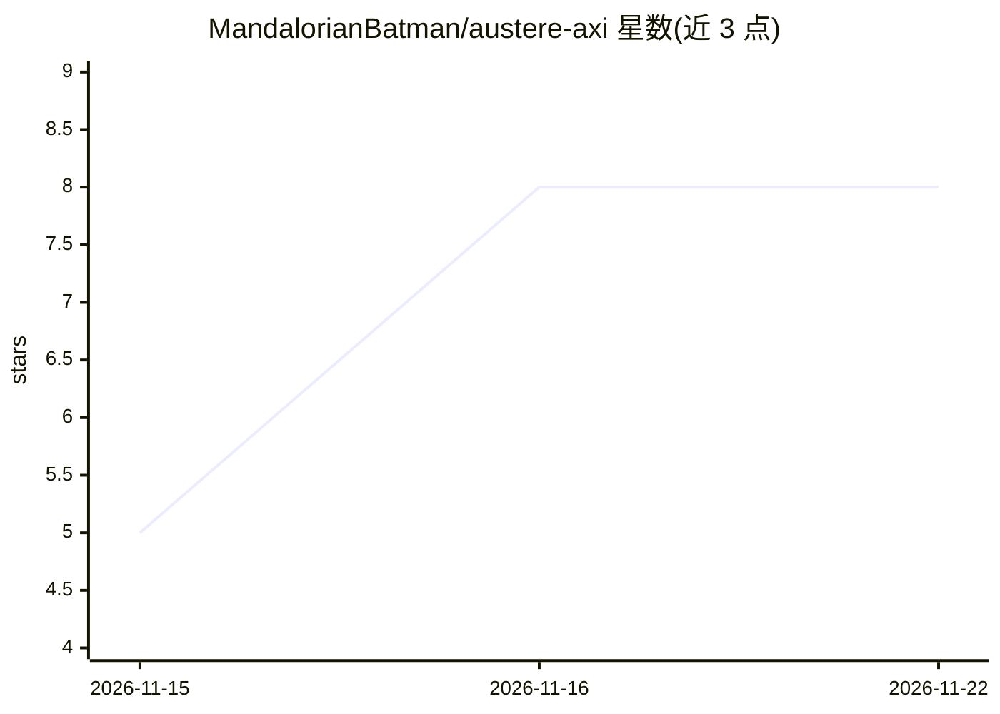

# MandalorianBatman/austere-axi

⭐ 8 · TypeScript · MIT · 推送 2026-11-20 · [GitHub](https://github.com/MandalorianBatman/austere-axi) · [官网](https://mandalorianbatman.github.io/austere-axi/) · 个人维护

**让编码 agent 把评审内容做成可点击页面并逐条接收批注的本地工具**

面向使用 AI 编码 agent 的开发者：agent 不再以长聊天消息返回方案，而是写出简短页面描述（OpenUI Lang），由本工具渲染为含表格、图示、代码变更与决策表单的页面；评审者在浏览器中点击具体元素写批注，批注按语句名回传，agent 只修改被指出的部分。默认在本地运行，无需账号；可发布页面邀请协作者，支持手机布局（需 Tailscale）与 GitHub Action 在 PR 上发布评审页。需 Node.js 22.18+ 与一个编码 agent。

## 筛选速览

| 维度 | 判定 | 备注 |
|---|---|---|
| AI 角色 | `ai-ecosystem` | LLM/agent 周边工具 |
| 许可风险 | `permissive` | MIT |
| 部署形态 | `library` | 以包/库形式分发 |
| 模型依赖 | locked-api |  |
| 硬件要求 | — | 无带数字的原话,不猜 |
| 安装摩擦 | `low` | 无编译、无系统依赖或容器化 |
| 成熟度 | — | 结构信号不足 |

## 能力要点

- agent 写简短页面描述，工具本地渲染评审页
- 批注按语句名定位，agent 仅修补被点击的部分
- 可发布页面按邀请协作，每条批注即时保存
- MIT 许可，基于 OpenUI 构建

## 适用场景

- 评审 agent 提出的迁移或设计方案并逐点批注
- 在浏览器里审阅 pull request 变更摘要
- 邀请团队成员对同一评审页留言后再决定哪些转给 agent

## 场景标签

`代码审查` `编码 Agent` · 领域:编码与开发

## 证据(README 行号)

> L7: **Review what your AI coding agent proposes on a page you can click, instead of in a wall of chat text.**
> L64: - An AI coding agent, such as Claude Code, Codex or Cursor.
> L92: With austere-axi the agent writes a short outline that names what goes on the page, and austere-axi draws it. Three

## 星数曲线

2026-11-15 5 → 2026-11-22 8（+3）

---
*卡片 v1 · prompt 1.4 · 生成 2026-11-20 · 置信度 high · 依据 README sha `9de30e26f78d` · [字段定义](../../DATASET.md)*
