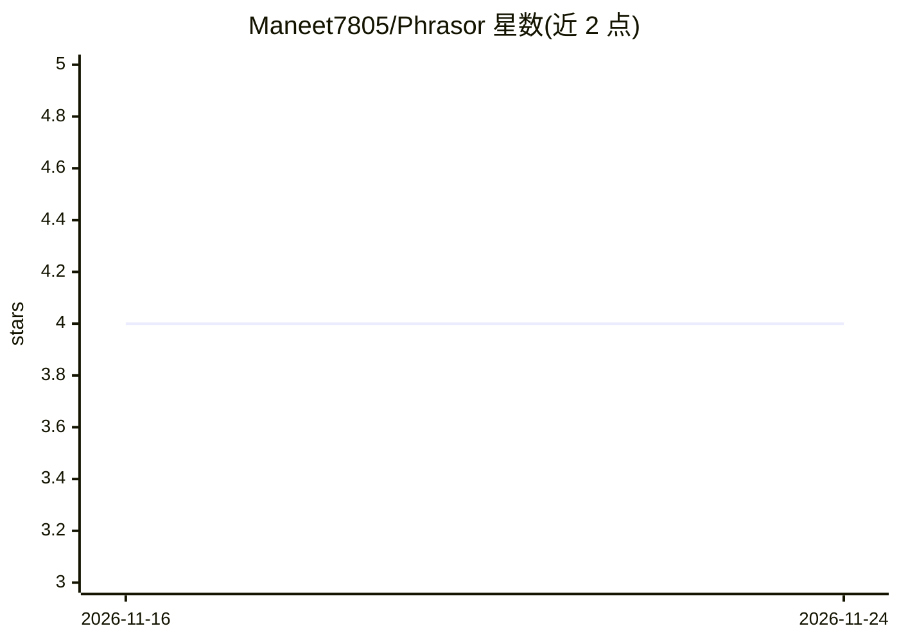

# Maneet7805/Phrasor

⭐ 4 · C# · MIT · 推送 2026-11-22 · [GitHub](https://github.com/Maneet7805/Phrasor) · [官网](https://maneet7805.github.io/Phrasor/) · 个人维护

**Windows 托盘应用：热键把草稿提示词改写为清晰版本**

驻留系统托盘的 Windows 工具，在任何文本框中按 Ctrl+Alt+P 即可捕获草稿提示词，调用模型改写后弹出审阅窗口，以词级 diff 展示修改并需用户确认才替换。内置三种改写模式、语音听写、保存历史、质量检查页（128 条测试集+可选 judge 模型）。改写前把代码/日志等粘贴内容按占位符掩码、事后逐字节还原，API key 经 Windows DPAPI 加密存储。默认使用 Groq 免费 API 层，也支持 Google Gemini key；未签名 exe，通过 SmartScreen 提示后运行。

## 筛选速览

| 维度 | 判定 | 备注 |
|---|---|---|
| AI 角色 | `ai-native` | 本体是模型或模型工具 |
| 许可风险 | `permissive` | MIT |
| 部署形态 | `desktop` | 安装包/桌面程序 |
| 模型依赖 | locked-api |  |
| 硬件要求 | — | 无带数字的原话,不猜 |
| 安装摩擦 | `medium` | 含编译或系统依赖之一 |
| 成熟度 | — | 结构信号不足 |

## 能力要点

- 全局热键改写任意文本框中的提示词，先审阅词级 diff 再替换
- 粘贴的代码/日志/文档按占位符掩码并在改写后逐字节还原
- 语音听写（Groq Whisper）与主/备双模型降级机制
- 内置 128 条测试集的质量检查页，可配独立 judge 模型

## 适用场景

- 在 ChatGPT、VS Code 等输入框中随手把潦草提示词改写清晰
- 只优化 Word 或代码编辑器中选中的长文本片段
- 用快捷键口述语音并转写（或转写后优化）为文本
- 用自带测试集对比改写规则改版前后的质量

## 场景标签

`提示工程` `AI 写作` · 领域:Agent 开发

## 证据(README 行号)

> L5: **Turn the rough prompt you're typing into a clear one without leaving the app you're in.**
> L21: Most prompts are typed in a hurry: no deliverable, missing context, details buried in a run-on sentence. Phrasor is
> L31: - **Free to run.** Uses Groq's free API tier by default. No card, no account with us, no server.

## 星数曲线

2026-11-16 4 → 2026-11-24 4（+0）

---
*卡片 v1 · prompt 1.4 · 生成 2026-11-21 · 置信度 high · 依据 README sha `32c18699ab36` · [字段定义](../../DATASET.md)*
