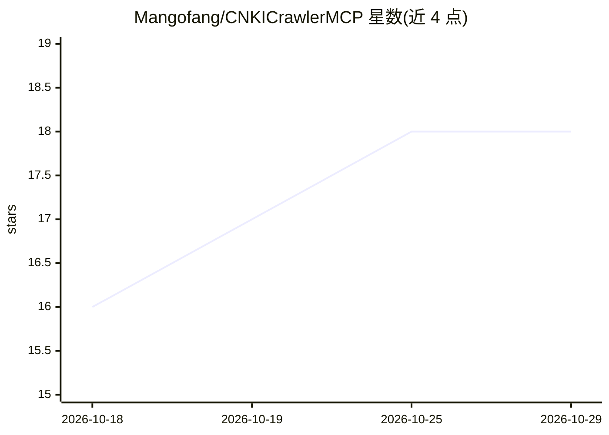

# Mangofang/CNKICrawlerMCP

⭐ 18 · Go · 推送 2026-10-16 · [GitHub](https://github.com/Mangofang/CNKICrawlerMCP) · 个人维护 · 中文 README

**为 AI 助手提供知网论文检索与正文提取的 MCP 爬虫服务**

用 Go 实现的 MCP 服务器，封装中国知网（CNKI）的爬取能力，供 Claude Desktop、Claude Code、Cursor 等 MCP 客户端作为外部工具调用。提供 5 个工具：论文关键词检索（ScanPaper）、论文详情获取（GetPaperInfo）、从 HTML 阅读页提取正文（GetPaperMainBody）、设置与读取全局 Cookie。正文仅限订阅套餐允许查看的范围。从源码构建需 Go 1.24.5+，README 附技术研究免责声明。

## 筛选速览

| 维度 | 判定 | 备注 |
|---|---|---|
| AI 角色 | `ai-ecosystem` | LLM/agent 周边工具 |
| 许可风险 | `none` | — |
| 部署形态 | `None` |  |
| 模型依赖 | — | README 未给出锁定关系 |
| 硬件要求 | — | 无带数字的原话,不猜 |
| 安装摩擦 | `low` | 无编译、无系统依赖或容器化 |
| 成熟度 | — | 结构信号不足 |

## 能力要点

- MCP 协议服务器，暴露 5 个知网检索/提取工具
- 论文搜索返回标题、作者、来源，并支持获取期刊影响因子
- 支持手动设置全局 Cookie 替代校园网 IP 登录
- Go 实现，go build 构建单一可执行文件

## 适用场景

- 在 Claude Code / Cursor 等 MCP 客户端中直接检索知网论文
- 让 AI 助手获取论文摘要与正文用于文献调研
- 查询期刊复合/综合影响因子

## 场景标签

`网页抓取` `科研工具` · 领域:效率与自动化

## 证据(README 行号)

> L3: 一个基于ModelContextProtocol(MCP)的中国知网（CNKI）学术论文爬虫服务，为AI助手（如ClaudeDesktop、Cursor、CluadeCode等）提供论文检索、信息获取和正文内容提取能力。
> L33: 在Claude Code的配置文件.claude.json中添加以下配置：

## 星数曲线

2026-10-18 16 → 2026-10-29 18（+2）

---
*卡片 v1 · prompt 1.4 · 生成 2026-10-29 · 置信度 high · 依据 README sha `bf16fe4e66d2` · [字段定义](../../DATASET.md)*
