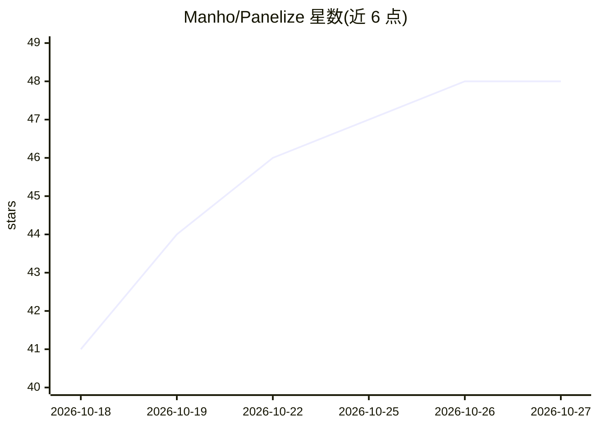

# Manho/Panelize

⭐ 48 · JavaScript · MIT · 推送 2026-10-23 · [GitHub](https://github.com/Manho/Panelize) · [官网](https://panelize.dev) · 个人维护 · 中文 README

**浏览器扩展：一条提示词同时发给多个 AI 聊天网站并排对比**

面向普通用户的 Chrome/Edge 扩展：在多面板窗口中加载各 AI 服务商官网（ChatGPT、Claude、Gemini、Grok、DeepSeek、Kimi、Qwen、豆包、智谱、Z.ai、元宝、Google 等），复用浏览器已有登录会话，一条提示词同时发送到所有面板并排查看回答，无需 API key。提供 22 种面板布局、带变量的提示词库、一键隐私模式，数据留在本地浏览器。安装途径为 Chrome Web Store 或开发者模式加载源码；仓库内含 Vitest/Playwright 测试与针对真实服务商站点的冒烟测试流程。MIT 许可。

## 筛选速览

| 维度 | 判定 | 备注 |
|---|---|---|
| AI 角色 | `ai-ecosystem` | LLM/agent 周边工具 |
| 许可风险 | `permissive` | MIT |
| 部署形态 | `library` | 以包/库形式分发 |
| 模型依赖 | locked-api |  |
| 硬件要求 | — | 无带数字的原话,不猜 |
| 安装摩擦 | `low` | 无编译、无系统依赖或容器化 |
| 成熟度 | — | 结构信号不足 |

## 能力要点

- 一条提示词同时发送到 12 家 AI 服务商并排对比
- 复用浏览器已有登录会话，无需 API key
- 22 种面板布局与支持 {topic} 变量的提示词库
- 数据留在本地浏览器，无跟踪与分析

## 适用场景

- 把同一个问题发给多个 AI 并排比较回答
- 保留各家官网原界面（自有套餐、模型选择与聊天记录）
- 快速切换对比布局做深度调研

## 场景标签

`聊天机器人` `模型评测` · 领域:对话与助手

## 证据(README 行号)

> L27: Panelize is a free, open-source Chrome and Edge extension that sends one prompt to ChatGPT, Claude, Gemini, Grok, D
> L39: Type your question once and send it to ChatGPT, Claude, Gemini, Grok, Doubao, DeepSeek, Kimi, Qwen, Zhipu (China), 

## 星数曲线

2026-10-18 41 → 2026-10-27 48（+7）

---
*卡片 v1 · prompt 1.4 · 生成 2026-10-25 · 置信度 mid · 依据 README sha `54131034002d` · [字段定义](../../DATASET.md)*
