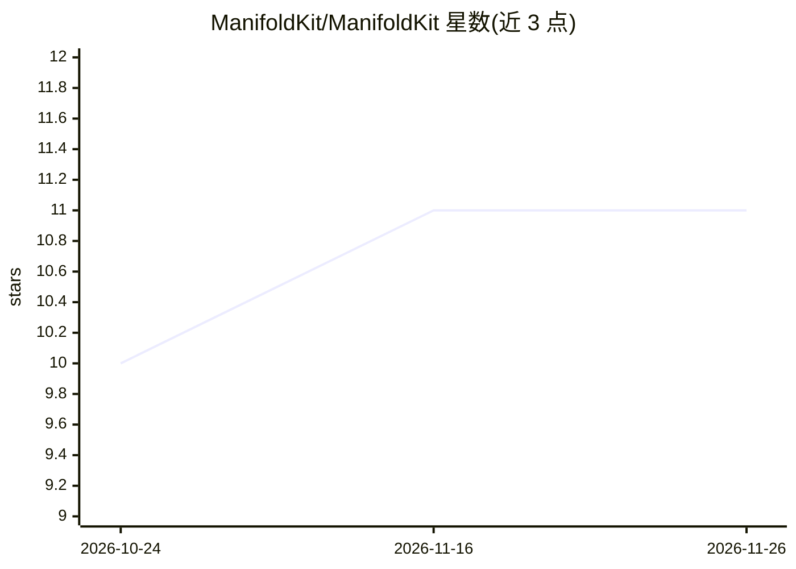

# ManifoldKit/ManifoldKit

⭐ 11 · Swift · MIT · 推送 2026-11-23 · [GitHub](https://github.com/ManifoldKit/ManifoldKit) · [官网](https://manifoldkit.github.io/ManifoldKit/) · 组织维护

**为 iOS/macOS 开发者提供的全栈 SwiftUI LLM 聊天框架**

面向 Apple 平台开发者的 Swift 软件包，将 SwiftUI ChatView、ConversationRuntime 轮次循环（发送/重生成/编辑/取消/分支）、SwiftData 持久化与多后端推理整合为一个可导入的聊天框架。核心内含 Apple Foundation Models、OpenAI、Anthropic、Ollama/LAN 后端，均实现统一 InferenceBackend 协议；端侧 MLX 与 llama.cpp/GGUF 以伴随包形式提供。要求 iOS/macOS 26+ 与 Swift 6.1+，通过 SwiftPM 安装，另提供 brew 安装的独立 OpenAI 兼容服务器。

## 筛选速览

| 维度 | 判定 | 备注 |
|---|---|---|
| AI 角色 | `ai-ecosystem` | LLM/agent 周边工具 |
| 许可风险 | `permissive` | MIT |
| 部署形态 | `None` |  |
| 模型依赖 | local-ok | 支持本地模型 |
| 硬件要求 | — | 无带数字的原话,不猜 |
| 安装摩擦 | `low` | 无编译、无系统依赖或容器化 |
| 成熟度 | — | 结构信号不足 |

## 能力要点

- SwiftUI ChatView + 会话轮次循环 + SwiftData 持久化 + 多后端推理一体化
- 统一 InferenceBackend 协议，覆盖端侧 MLX/llama.cpp 与云后端
- 28 个库的分层模块结构，支持按需取用 UI 或引擎
- 内置 TLS pinning、工具审批门、6,500+ 测试与 mock 后端

## 适用场景

- 在 iOS/macOS 应用中快速接入聊天界面与多后端推理
- 将本地 GGUF/MLX 模型与云 API 按同一协议接入应用
- 将 ManifoldKit 作为 OpenAI 兼容服务器供 Cursor 等客户端调用

## 场景标签

 · 领域:LLM 应用开发框架

## 证据(README 行号)

> L11: The only open-source Swift package that bundles UI, turn-loop runtime, persistence, and multi-backend inference int
> L17: ManifoldKit is a full-stack, multi-backend AI chat framework for iOS 26+ / macOS 26+. Import one umbrella package a

## 星数曲线

2026-10-24 10 → 2026-11-26 11（+1）

---
*卡片 v1 · prompt 1.4 · 生成 2026-11-19 · 置信度 high · 依据 README sha `6c4339232da9` · [字段定义](../../DATASET.md)*
