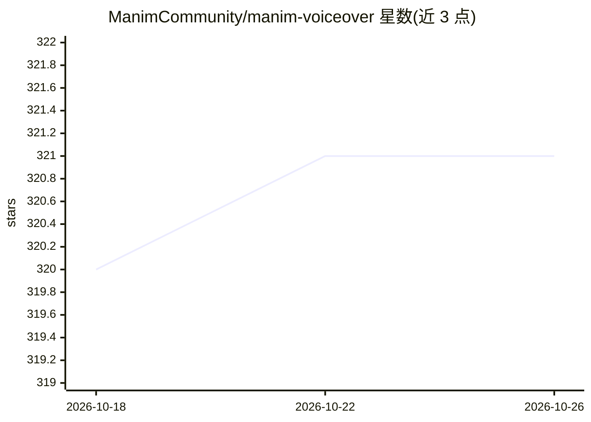

# ManimCommunity/manim-voiceover

⭐ 321 · Python · MIT · 推送 2026-06-15 · [GitHub](https://github.com/ManimCommunity/manim-voiceover) · [官网](https://voiceover.manim.community/en/stable) · 组织维护

**给 Manim 动画视频直接添加配音的插件**

Manim Community 维护的 Manim 插件：在 Python 中直接为 Manim 视频添加配音，无需视频编辑器；支持渲染时通过命令行用麦克风录制配音，或接入多种免费与商业 TTS 服务自动生成 AI 语音，当前支持 Gemini TTS、Azure TTS、gTTS 与 pyttsx3；借助 OpenAI Whisper 实现逐词时间对齐，可在配音的特定词处触发动画；另支持 DeepL 等机器翻译服务将配音译为其他语言。面向制作数学动画的开发者。

## 筛选速览

| 维度 | 判定 | 备注 |
|---|---|---|
| AI 角色 | `ai-native` | 本体是模型或模型工具 |
| 许可风险 | `permissive` | MIT |
| 部署形态 | `library` | 以包/库形式分发 |
| 模型依赖 | — | README 未给出锁定关系 |
| 硬件要求 | — | 无带数字的原话,不猜 |
| 安装摩擦 | `low` | 无编译、无系统依赖或容器化 |
| 成熟度 | — | 结构信号不足 |

## 能力要点

- 在 Python 中直接为 Manim 视频添加配音，无需视频编辑器
- 支持 Gemini/Azure TTS、gTTS、pyttsx3 等多种 TTS 服务及麦克风录制
- 基于 OpenAI Whisper 的逐词时间对齐，可在特定词触发动画
- 可经 DeepL 等机器翻译服务翻译配音

## 适用场景

- 给数学动画视频添加 TTS 或自己录制的配音
- 在配音说到某个词时精确触发动画
- 将配音翻译成其他语言多语言发布

## 场景标签

`语音合成` · 领域:内容生成

## 证据(README 行号)

> L14: - Develop animations with auto-generated AI voices from various free and proprietary services.
> L21: Currently supported TTS services (aside from the CLI that allows you to records your own voice):

## 星数曲线

2026-10-18 320 → 2026-10-26 321（+1）

---
*卡片 v1 · prompt 1.4 · 生成 2026-10-21 · 置信度 high · 依据 README sha `a1d42066bebe` · [字段定义](../../DATASET.md)*
