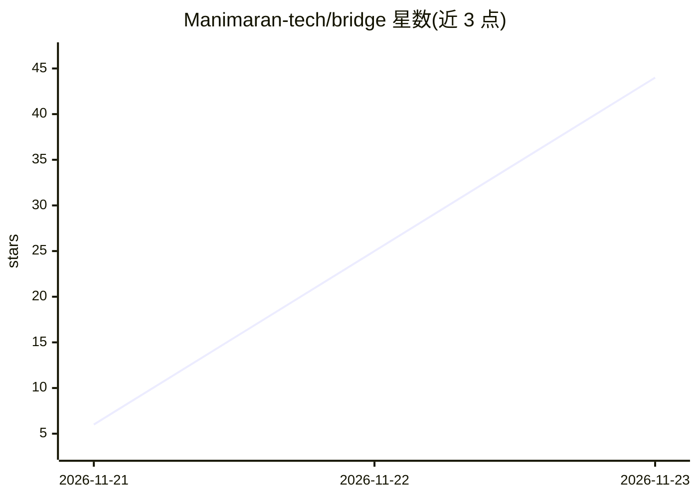

# Manimaran-tech/bridge

⭐ 44 · JavaScript · MIT · 推送 2026-11-22 · [GitHub](https://github.com/Manimaran-tech/bridge) · [官网](https://www.npmjs.com/package/@markmayandi/bridge) · 个人维护 · 中文 README

**把本地代码目录通过 MCP 隧道安全接入网页版 AI 客户端的 CLI**

一个 Node.js 命令行工具，在本地启动受令牌保护的 MCP 守护进程，并通过 Cloudflare 隧道生成带 Bearer token 的 HTTPS 端点，供 Claude Web、ChatGPT Web、Gemini、DeepSeek 等网页 AI 客户端粘贴接入。接入后模型可对指定项目目录执行读写、编辑与终端测试。安全机制包括目录囚笼、symlink 边界检查、仅绑定 127.0.0.1、--disable-shell 限制执行、实时流量审计；支持 npx 免安装运行与命名隧道固定 URL。

## 筛选速览

| 维度 | 判定 | 备注 |
|---|---|---|
| AI 角色 | `ai-ecosystem` | LLM/agent 周边工具 |
| 许可风险 | `permissive` | MIT |
| 部署形态 | `library` | 以包/库形式分发 |
| 模型依赖 | locked-api |  |
| 硬件要求 | — | 无带数字的原话,不猜 |
| 安装摩擦 | `low` | 无编译、无系统依赖或容器化 |
| 成熟度 | — | 结构信号不足 |

## 能力要点

- 零配置 Anycast 隧道 + 自动生成 24 字节加密令牌并复制端点到剪贴板
- 目录囚笼与 realpath/symlink 边界校验，禁止越出项目根目录
- 内置 read/write/edit/bash/pwsh 等本地编码工具集，可 --disable-shell
- 终端仪表盘支持实时流量流、目录切换、快捷键复制 URL/token

## 适用场景

- 让网页版 Claude/ChatGPT 直接读写本地项目文件而无需开放端口
- 在受控沙箱下让 AI 客户端执行终端测试命令
- 用命名 Cloudflare 隧道获得固定的 MCP 接入地址

## 场景标签

 · 领域:开发者工具/AI 编码基础设施

## 证据(README 行号)

> L15:  Securely connect your local codebases and development environments to Claude Web, ChatGPT, Gemini, and DeepSeek in
> L110: Cloud-based AI models cannot safely access files on your physical machine without open ports or copy-pasting code 
> L113: * **Native Tool Suite:** Exposes native coding tools (`read`, `write`, `edit`, `str_replace_editor`, `pwsh`, `bash

## 星数曲线

2026-11-21 6 → 2026-11-23 44（+38）

---
*卡片 v1 · prompt 1.4 · 生成 2026-11-21 · 置信度 high · 依据 README sha `06a56dc2bb1a` · [字段定义](../../DATASET.md)*
